No pude guardar `.viltrum/crm-ux/D03-topologia-vps-supabase.md`: esta sesión tiene el filesystem en modo de solo lectura. Dejo el entregable completo a continuación. No modifiqué archivos ni ejecuté operaciones sobre infraestructura.

# D03 — Topología VPS Hostinger / Supabase

**Fecha:** 2026-10-03  
**Productor:** D03, arquitectura de solución.  
**Estado:** propuesto; pendiente de revisión independiente.  
**Clasificación:** integración de CRM existente, riesgo R3.  
**Alcance:** análisis documental y lectura de código; sin despliegue, migraciones ni cambios de configuración.

## 1. Conclusión y alcance de la evidencia

La topología prescrita por la documentación es:

- **CRM:** aplicación local en desarrollo y aplicación en la VPS para staging y producción; PostgreSQL y Supabase Auth en **un proyecto Supabase Cloud distinto por entorno**.
- **Portal/CMS:** conserva su infraestructura existente en la VPS. Su Supabase de producción no se convierte en la base ni en el proveedor Auth del CRM.
- **Integración:** el servidor del Portal entrega solicitudes comerciales al endpoint existente del CRM. Los sistemas no comparten tablas, cuentas Auth, contraseñas ni claves administrativas.

Esto sigue `docs/DESPLIEGUE.md` §1 y §5. El título de la decisión #12 resulta ambiguo, pero su contenido describe PostgreSQL gestionado por Supabase y aplicación alojada en Hostinger.

### Evidencia y límites

| Fuente | Qué acredita | Límite |
|---|---|---|
| [TAREA.md](../dispatch/20261003T163631Z-D03-codex/TAREA.md) | Estado de VPS y configuración local aportado por el orquestador | No inspeccionado directamente por D03 |
| [DESPLIEGUE.md](../../docs/DESPLIEGUE.md), §1 y §5 | Un proyecto Cloud por entorno; aplicación en VPS; despliegue aplazado | No acredita infraestructura desplegada |
| [SUPABASE.md](../../docs/SUPABASE.md) | Preparación de Cloud, conexión y relación Auth–usuario CRM | Contiene instrucciones antiguas |
| [decisiones.md](../../docs/contexto/decisiones.md), #12, #17, #28, #39 y #40 | Hosting, despliegue, invitaciones, secretos y RLS | No acredita aplicación efectiva en runtime |
| [env.ts](../../src/infrastructure/env.ts) | Cinco variables del contrato actual | No se leyeron sus valores |
| [auth/actor.ts](../../src/infrastructure/auth/actor.ts), [middleware.ts](../../src/middleware.ts) y [auth/demo/route.ts](../../src/app/api/auth/demo/route.ts) | Verificación de identidad y existencia de acceso demo | Análisis estático, sin reproducción |
| [leads/externo/route.ts](../../src/app/api/leads/externo/route.ts) | Contrato receptor de captura externa | Emisor del Portal no inspeccionado |
| [0001_enable_rls_public_tables.sql](../../drizzle/0001_enable_rls_public_tables.sql) | Migración que activa RLS en 29 tablas | Aplicación a cada base no verificada |
| [commercial.md](../commercial.md) | Declara C1 activo y excluye despliegue automático a producción | D03 no valida ni amplía esa aceptación |

**Versión:** documentos y código disponibles en esta sesión. Commit y correspondencia con remoto **no verificados**; no se utilizó `git`.

No se abrieron archivos `.env`, se listaron variables del proceso ni se consultó la VPS, Docker, Supabase Cloud o servicios externos. `.env.example` se procesó extrayendo únicamente nombres. No se observaron secretos reales en las salidas consultadas.

## 2. Estado actual comunicado

Según el orquestador:

| Componente | Ubicación y aislamiento | Interpretación |
|---|---|---|
| Supabase de producción del Portal/CMS | VPS; contenedores `supabase-*`; red `supabase_default` | Infraestructura existente del Portal |
| Base `quisqueya-staging-db` | VPS; red `quisqueya_staging`; sin puertos públicos | Base aislada existente; pertenencia funcional exacta pendiente de comprobar |
| Túnel de staging | Acceso local por loopback mediante SSH | Herramienta administrativa; no proveedor Auth |
| `quisqueya-portal-staging` | VPS | Aplicación de staging existente; conexión efectiva no inspeccionada |
| Configuración local del CRM | Apunta Auth a un Supabase local inexistente en esta PC | Explica el bloqueo del login según el diagnóstico recibido |

**Una base PostgreSQL aislada no equivale a una instalación Supabase completa.** La tarea no acredita que staging tenga un Auth propio. Tampoco acredita versiones, salud, configuración SMTP, respaldos o exposición efectiva de los servicios del Portal.

La base de staging de la VPS no debe recibir automáticamente migraciones del CRM: su propietario y consumidores deben comprobarse primero.

## 3. Topología objetivo por entorno

El siguiente diagrama representa una **propuesta**, no infraestructura ya desplegada.

```mermaid
flowchart TB
  subgraph DEV["Desarrollo"]
    BD["Navegador de desarrollo"]
    CD["CRM Next.js en PC"]
    subgraph CLOUDD["Supabase Cloud exclusivo CRM dev"]
      AD["Auth dev"]
      DD["PostgreSQL CRM dev"]
      SD["Storage privado dev"]
    end
    BD --> CD
    BD -->|"HTTPS: operaciones Auth"| AD
    CD -->|"HTTPS: sesión e invitaciones"| AD
    CD -->|"SQL sobre TLS; acceso restringido"| DD
    CD -->|"HTTPS: archivos autorizados"| SD
    AD -->|"Datos internos de identidad"| DD
  end

  subgraph STAGING["Staging"]
    BS["Navegador de QA"]
    subgraph VPSS["VPS: aislamiento de staging"]
      RS["Entrada HTTPS"]
      CS["CRM staging: proceso separado"]
      PS["Portal staging existente"]
      DS["quisqueya-staging-db: red privada"]
      AS["Auth Portal staging: no verificado"]
      RS --> CS
      PS -.->|"Conexión por verificar"| DS
      PS -.->|"Proveedor por verificar"| AS
      PS -.->|"Captura de leads: contrato a validar"| CS
    end
    subgraph CLOUDS["Supabase Cloud exclusivo CRM staging"]
      ACS["Auth CRM staging"]
      DCS["PostgreSQL CRM staging"]
      SCS["Storage privado staging"]
    end
    BS -->|"HTTPS"| RS
    BS -->|"HTTPS: operaciones Auth"| ACS
    CS -->|"HTTPS: sesión e invitaciones"| ACS
    CS -->|"SQL sobre TLS; acceso restringido"| DCS
    CS -->|"HTTPS: archivos autorizados"| SCS
    ACS -->|"Datos internos de identidad"| DCS
  end

  subgraph PROD["Producción"]
    BP["Navegador del CRM"]
    subgraph VPSP["VPS: aplicaciones y redes separadas"]
      RP["Entrada HTTPS"]
      CP["CRM producción"]
      PP["Portal CMS producción existente"]
      SP["Supabase Portal: PostgreSQL privado"]
      AP["Auth Portal: runtime por verificar"]
      RP --> CP
      PP -->|"Red privada supabase_default"| SP
      PP -.->|"Servicio Auth por verificar"| AP
      PP -.->|"HTTPS: captura de leads"| CP
    end
    subgraph CLOUDP["Supabase Cloud exclusivo CRM producción"]
      ACP["Auth CRM producción"]
      DCP["PostgreSQL CRM producción"]
      SCP["Storage privado producción"]
    end
    BP -->|"HTTPS"| RP
    BP -->|"HTTPS: operaciones Auth"| ACP
    CP -->|"HTTPS: sesión e invitaciones"| ACP
    CP -->|"SQL sobre TLS; acceso restringido"| DCP
    CP -->|"HTTPS: archivos autorizados"| SCP
    ACP -->|"Datos internos de identidad"| DCP
  end

  OP["Operador autorizado"]
  OP -.->|"Túnel SSH; escucha local loopback"| DS
```

### Fronteras y conexiones

1. El navegador utiliza Auth y la aplicación. No recibe acceso SQL, credenciales de base ni `service_role`.
2. El servidor CRM consulta PostgreSQL mediante Drizzle. Verifica la identidad contra el Auth correspondiente y la cruza con la fila activa de `users`.
3. En cada entorno, URL Auth, clave pública, clave administrativa y conexión PostgreSQL deben pertenecer al **mismo proyecto CRM**.
4. Las migraciones del CRM solo gobiernan sus bases Cloud. Las del Portal gobiernan sus bases propias.
5. Los contenedores CRM no necesitan pertenecer a `supabase_default` ni acceder a PostgreSQL del Portal.
6. Las cookies, dominios y credenciales de staging deben quedar separados de producción.
7. El túnel administrativo no se utiliza como dependencia del CRM desplegado.

### Condición sobre puertos de base de datos

La propuesta no requiere publicar puertos PostgreSQL en la VPS. Los accesos administrativos a sus bases permanecen en redes privadas o túneles con escucha local.

La documentación prescribe el **session pooler de Supabase Cloud**, pero no demuestra que su endpoint sea privado ni que existan restricciones de origen activas.

Por tanto:

- D16 debe verificar TLS y aplicar restricciones de red que limiten el acceso SQL a los orígenes autorizados, si la modalidad contratada las admite.
- D12 debe comprobar que PostgreSQL no quede accesible de forma indiscriminada desde Internet.
- Si el requisito significa **ausencia absoluta de endpoints SQL enrutables por Internet**, la conexión al pooler descrita en los documentos no acredita su cumplimiento. D16/D21 deben verificar una modalidad privada compatible antes de ejecutar esta propuesta.

No se presenta una conexión autenticada o cifrada como equivalente a una red privada.

## 4. Relación CRM–Portal/CMS

### Propiedad de datos propuesta

| Datos | Propietario | Intercambio |
|---|---|---|
| Contenido editorial y presentación del Portal | Portal/CMS | Sin acceso directo del CRM a sus tablas |
| Contactos, leads, asignaciones, negocios y comisiones | CRM | El Portal entrega solicitudes de captación |
| Roles, permisos y auditoría CRM | CRM | No se comparten con visitantes ni usuarios del CMS |
| Identidades Auth | Cada aplicación y entorno | No hay SSO aprobado |
| Fotografías de avance de obra | CRM | Storage propio por entorno |
| Identificadores de proyectos y canales | Cada sistema | Traducción explícita; no asumir IDs coincidentes |

La titularidad de información comercial que también aparezca en el Portal debe acordarse con D01/D11. No se verificó un contrato existente de sincronización de propiedades.

### Contrato de captura existente

El receptor verificado en código es:

- **Operación:** `POST /api/leads/externo`.
- **Autenticación:** cabecera `x-webhook-token`, contrastada con el secreto del entorno CRM.
- **Obligatorios:** `externalId` y `fullName`.
- **Opcionales:** contacto, interés, proyecto, canal, presupuesto, moneda, campaña y atribución; el esquema Zod está en la ruta.
- **Respuesta exitosa:** `ok`, `lead` y `creado`.
- **Token ausente o incorrecto:** respuesta 401.
- **Idempotencia:** reutiliza el lead activo con el mismo `externalId`; no es una garantía de entrega exactamente una vez.

El código documenta una unicidad parcial: un lead eliminado no participa en esa deduplicación. D19 debe considerar este comportamiento al definir reintentos tardíos.

Para conectar el Portal:

1. El **servidor del Portal** conserva el token y realiza la llamada. El navegador del visitante nunca lo recibe.
2. Cada entorno usa destino y token propios.
3. `externalId` identifica una entrega estable; los reintentos conservan el mismo identificador.
4. Los IDs del Portal se traducen a IDs CRM. Sin correspondencia validada, se usa el interés textual admitido por el contrato.
5. El Portal no devuelve al visitante el objeto completo `lead`, que puede contener datos personales o internos.
6. D19 documenta timeouts, reintentos limitados y recuperación de entregas fallidas. Su implementación en el Portal **no está verificada**.

El flujo Portal→CRM es una conexión a validar; la presencia del receptor no acredita que el Portal ya la utilice. Una sincronización inversa requeriría otro contrato y revisión de alcance.

## 5. Variables por entorno

Solo se indican nombres y destinos. No se incluyen valores.

| Nombre | Desarrollo | Staging | Producción | Alcance |
|---|---|---|---|---|
| `NEXT_PUBLIC_SUPABASE_URL` | API del proyecto Cloud CRM dev | API del proyecto Cloud CRM staging | API del proyecto Cloud CRM producción | Pública; Auth/API |
| `NEXT_PUBLIC_SUPABASE_ANON_KEY` | Clave pública CRM dev | Clave pública CRM staging | Clave pública CRM producción | Pública por diseño |
| `DATABASE_URL` | PostgreSQL CRM dev | PostgreSQL CRM staging | PostgreSQL CRM producción | Secreto; solo servidor |
| `SUPABASE_SERVICE_ROLE_KEY` | Administración Auth/Storage CRM dev | Administración Auth/Storage CRM staging | Administración Auth/Storage CRM producción | Secreto administrativo; solo servidor |
| `LEADS_WEBHOOK_TOKEN` | Emisor de pruebas autorizado | Servidor Portal staging autorizado | Servidor Portal producción autorizado | Secreto de integración; solo servidores |

Los cinco nombres están presentes en `env.ts` y en las asignaciones de `.env.example`.

También se encontraron `NODE_ENV` y `CRM_DEMO_MODE` fuera del contrato centralizado. Son controles de ejecución que D12/D10 deben revisar: la combinación de modo demo y cookie de rol permite construir un actor sin identidad Supabase.

**SMTP y Google:** no se verificaron variables CRM para estas configuraciones. No se inventan nombres. SMTP de Auth se configura en el proyecto Supabase correspondiente. Google OAuth requeriría configuración del proveedor y flujo de aplicación verificado; no forma parte del login por contraseña observado.

## 6. Pasos ordenados para dejarlo funcionando

Son acciones futuras; ninguna fue ejecutada por D03.

| Orden | Responsable | Acción concreta | Evidencia necesaria |
|---|---|---|---|
| 1 | D00/D16 | Inventariar proyectos Cloud existentes y propietarios de las bases VPS, sin mostrar secretos | Mapa de entorno, aplicación, PostgreSQL y Auth |
| 2 | D12/D10 | Revisar el acceso demo antes de conectar datos reales; las correcciones corresponden a Claude bajo el reparto vigente | Rechazo de acceso sin identidad válida |
| 3 | Wilber | Confirmar el proyecto Cloud exclusivo de desarrollo o crearlo si no existe; después preparar staging y producción en su fase autorizada | Tres destinos independientes; sin duplicar proyectos existentes |
| 4 | Wilber | Introducir las credenciales mediante el canal privado de configuración, nunca en chat o entregables | Presencia y correspondencia comprobadas sin valores |
| 5 | D16 | Sustituir el destino Auth local inexistente por Cloud dev y alinear las cinco variables | Comprobación redactada de destino y entorno |
| 6 | D16/D12 | Verificar DNS, TLS, modo de conexión y restricciones de origen; resolver el requisito de conectividad privada | Resultado de conectividad y control de red |
| 7 | Claude/D11, coordinados por D16 | Revisar y aplicar migraciones Drizzle y seed al proyecto correcto; respaldar previamente si contiene datos | Journal, catálogos y RLS comprobados en la base |
| 8 | Wilber/D11 | Preparar el primer administrador con identidad Auth enlazada a una fila CRM activa | Enlace correcto y rol aprobado, sin publicar PII |
| 9 | Wilber | Preparar SMTP, remitente y dominio; configurar en cada Auth su origen y redirecciones permitidas | Entrega de invitación y recuperación al entorno correcto |
| 10 | D11/D16 | Crear/verificar el bucket privado `avances-obra`, utilizado por el adaptador actual | Subida autorizada y lectura mediante URL firmada |
| 11 | Codex/D14 | Probar el login real y los permisos en la vitrina ya levantada por el responsable | Recorrido de interfaz y pruebas negativas |
| 12 | D19 | Verificar el emisor Portal→CRM, traducción de IDs, token por entorno y reintentos | Captura y repetición sin duplicar lead activo |
| 13 | D16/D12 | Preparar staging con proceso, credenciales y proyecto Cloud exclusivos cuando corresponda | Sesiones y datos de producción inaccesibles desde staging |
| 14 | D11/D16 | Ensayar respaldo y restauración en un destino aislado, incluyendo identidad y archivos pertinentes | Restauración comprobada, no solo archivo generado |
| 15 | D16/D12/Wilber | En la fase de entrega de #17, revisar la versión concreta, reversión y autorización de producción | Evidencia técnica y autorización humana por operación |

### Qué requiere específicamente a Wilber

- Cuenta, propiedad y creación o confirmación de los proyectos Cloud.
- Custodia e introducción privada de credenciales.
- Proveedor SMTP, remitente y acceso al dominio para su configuración.
- Presupuesto, retención, disponibilidad, RPO y RTO.
- Autorización de cualquier operación de producción.
- Aclaración sobre **Google**: login OAuth o integración Calendar.

El código inspeccionado usa login por contraseña. La decisión #26 sitúa la sincronización bidireccional con Google Calendar en una fase posterior. Crear credenciales Google no completa ninguna de esas funcionalidades; su incorporación requiere alcance autorizado.

### Comprobaciones de aceptación pendientes

- Login real sin cookie demo.
- Sesión Auth sin usuario CRM activo: acceso rechazado.
- Usuario inactivo o eliminado: acceso rechazado.
- Broker: no alcanza registros de otro responsable.
- Sesión de staging: no autentica contra producción.
- Token inválido de captura: 401.
- Repetición de una entrega: mismo lead activo.
- Invitación, recuperación y cierre de sesión completos.
- Fotografías inaccesibles sin autorización.
- Puertos PostgreSQL VPS sin publicación a Internet.
- Restauración utilizable y reversión de aplicación ensayadas.

Codex no debe levantar servidores ni ejecutar `dev` o `build`. Las verificaciones completas de código corresponden al responsable autorizado; D03 no declara ninguna en verde.

## 7. Riesgos y mitigaciones

| Riesgo / evidencia | Escenario | Mitigación y propietario |
|---|---|---|
| **Acceso demo** — `actor.ts:33`, `middleware.ts:58`, `auth/demo/route.ts:11` | Con modo desarrollo o demo habilitado, una cookie de rol produce un actor sin identidad Auth. El endpoint demo no contiene una restricción explícita de entorno | D12/D10: corregir mediante Claude y demostrar rechazo en entornos conectados a datos reales. No reproducido por D03 |
| **RLS no protege el acceso SQL administrativo** — migración `0001`, comentarios iniciales | La migración describe Drizzle usando un rol que ignora RLS; un fallo de autorización del servidor puede alcanzar datos | D12/D11: comprobar rol efectivo y privilegios; conservar `requireScope`, `visibleRows`/`reaches` y pruebas reales por alcance |
| **`service_role`** — `env.ts:43`, `supabase.ts:56` | Filtración permite operaciones administrativas fuera del RBAC del usuario | Solo servidor, secretos separados, redacción de logs, rotación y revisión de permisos antes de cada operación |
| **Destinos mezclados** | Auth de un proyecto con PostgreSQL de otro; sesiones compartidas entre entornos | D16: validar correspondencia antes de arrancar o migrar |
| **Exposición de PostgreSQL** | Publicación de puertos VPS o endpoint Cloud sin restricciones requeridas | D16/D12: redes privadas, túnel local, TLS y controles de origen verificados |
| **Respuesta de captura con datos internos** — `leads/externo/route.ts:98` | El Portal retransmite el objeto `lead` al visitante | D19/D12: consumir respuesta en servidor y devolver una confirmación mínima |
| **Consentimiento no acreditado** — `casos-de-uso.ts:325` | El CRM registra consentimiento al crear el contacto; no demuestra que el Portal lo recabara | D01/D12: verificar evidencia de consentimiento y necesidad de ajustar el contrato |
| **Respaldos incompletos** | Respaldo SQL recuperado sin usuarios Auth utilizables o sin objetos Storage | D11/D16: inventario de activos, ensayo completo, retención y custodia |
| **Credenciales históricas de pruebas** — decisión #39 | Cuentas o contraseñas antiguas siguen utilizables | D12/Claude: comprobar el estado actual y cerrar cuentas/credenciales. El script no fue abierto |
| **Fallo compartido de VPS** | Caída o falta de memoria afecta CRM y Portal simultáneamente | D16/D17: recursos, reinicio, alertas y despliegue reversible; objetivos numéricos pendientes |

La existencia de una migración RLS o de una prueba estática no demuestra que el control opere en la base desplegada.

Controles favorables observados: cliente público separado del administrativo; identidad normal cruzada con `users` activo; validación Zod y asignación explícita en captura; migración RLS presente; bucket accedido mediante adaptador con URLs firmadas. Su eficacia en runtime permanece pendiente.

No se verificaron planes, precios, retención, PITR ni funcionalidades actuales de red del proveedor. Las afirmaciones de `DESPLIEGUE.md` sobre respaldos incluidos no deben convertirse en garantías operativas sin comprobación del proyecto contratado.

## 8. Contradicciones y aclaraciones

| Documentación / código | Estado o evidencia contrapuesta | Resolución propuesta |
|---|---|---|
| Cloud en desarrollo; local descartado | El orquestador informa Auth local inexistente configurado | Corregir el destino hacia Cloud dev |
| “No hay staging ni producción” | Hay Portal/CMS de producción y componentes staging en VPS | Precisar que el aplazamiento corresponde al **CRM**, no a toda la VPS |
| Decisión #12 titulada “Supabase … sobre VPS” | El cuerpo y `DESPLIEGUE.md` describen CRM Cloud + aplicación VPS | Registrar una aclaración nueva; conservar las decisiones históricas |
| Guías de “tres variables” | `env.ts` declara cinco | Actualizar guías incluyendo integración e invitaciones |
| `SUPABASE.md`: CRM no usa `service_role` | Decisión #28 y código la usan para Auth y Storage | Mantener prohibición en cliente; documentar uso administrativo servidor |
| Crear usuarios manualmente; M13 pendiente | #28 y relevo acreditan invitaciones implementadas | Distinguir bootstrap inicial del alta normal |
| Instrucción inicial “Direct connection” seguida de “Session pooler” | Guía contradictoria dentro del mismo apartado | Unificar tras verificar conectividad del entorno |
| Arquitectura enumera solo Contactos migrado | Relevo declara R3 completa | Actualizar inventario desde código y evidencia vigente |
| Relevo: siguiente R4.1 | Su §3 todavía anuncia R3.6 | Corregir el relevo por su propietario |
| Estado Viltrum: 358 pruebas; relevo: 334 | D03 no presenció ninguna corrida | No certificar conteo ni cierre |
| Variables centralizadas en `env.ts` | Middleware y actor leen configuración directamente | D10/D12: revisar centralización y política demo |
| Storage local descrito como apagado | Código de Proyectos usa Storage para avances | Verificar servicio y bucket por entorno |
| Plan Free y respaldos descritos como suficientes | No hay verificación actual del proveedor ni NFR aprobados | Comprobar cobertura real antes de contratar o desplegar |

La base privada staging de la VPS no contradice por sí sola la separación prescrita para el CRM: primero debe acreditarse a qué aplicación pertenece.

## 9. Decisiones propuestas y pendientes

**ADR propuesto A:** conservar tres proyectos Supabase Cloud independientes para el CRM. Evita compartir identidad y datos entre entornos. No se propone trasladar el Supabase del Portal.

**ADR propuesto B:** integrar Portal→CRM mediante el receptor existente y un emisor servidor. Evita compartir bases y claves administrativas. El emisor y la correspondencia de datos permanecen por verificar.

**ADR propuesto C:** excluir acceso demo de cualquier conexión a datos reales. Su corrección requiere revisión independiente; no se cambia código en este análisis.

No están aprobados estos ADR. Tampoco están definidos volumen, concurrencia, latencia, disponibilidad, retención, RPO/RTO o presupuesto. Sin esos datos no se certifican capacidad, costo ni arquitectura operativa definitiva.

## Handoff

**Destinatarios:** D16 y D12.  
**Apoyo necesario:** D11 para datos/restauración; D19 para el emisor Portal; D01/D02 para NFR y alcance de Google.  
**Revisor de arquitectura D03:** humano, según el registro. D03 no aprueba esta propuesta.

**D16 recibe:**

- Topología provisional y matriz de configuración.
- Separación explícita entre infraestructura Portal existente y CRM objetivo.
- Secuencia de preparación sin operaciones ejecutadas.
- Pendientes de conectividad privada, proyectos existentes, aislamiento, SMTP, Storage, restauración y reversión.
- Obligación de respetar #17 y la exclusión de despliegue automático.

**D12 recibe:**

- Hallazgo estático de acceso demo con rutas y líneas.
- Fronteras de `service_role`, SQL administrativo y RLS.
- Riesgos de captura externa, respuesta con PII, consentimiento y secretos históricos.
- Condición de revisión independiente antes de conectar datos reales o autorizar producción.

**Para aceptar el siguiente handoff:** verificar destinos por entorno, ausencia de bypass de identidad, aislamiento efectivo, RLS aplicado, restricciones de red, entrega de correo, contrato Portal→CRM y restauración completa. Adjuntar evidencia redactada y firma del revisor correspondiente.

**Limitación de entrega:** el análisis está completo en esta respuesta, pero el archivo solicitado no pudo persistirse por la restricción de escritura del entorno. No se cierra ningún issue, gate, C1 ni criterio de aceptación.