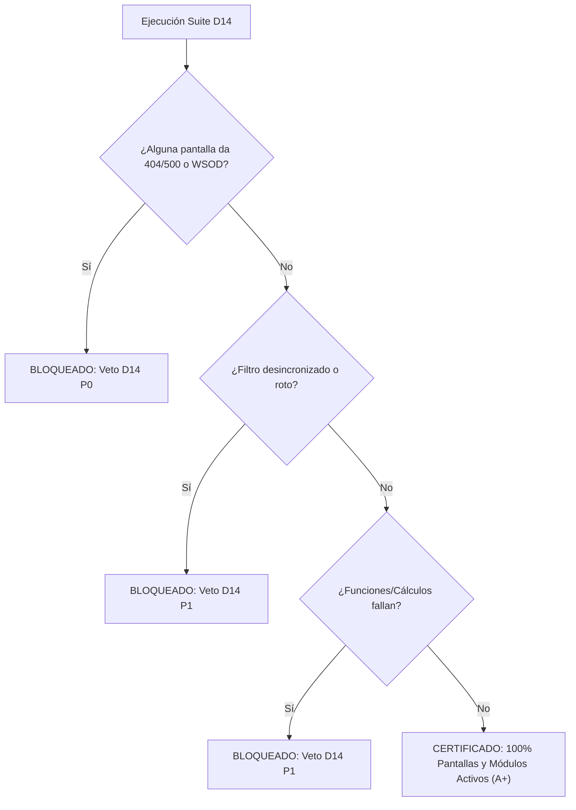

# Checklist D14: Matriz de Pantallas, Funciones, Filtros y Módulos (Protocolo "Nada Abajo")

> **Objetivo:** Garantizar que ninguna pantalla, función matemática/financiera, filtro o módulo interactivo colapse, genere pantalla blanca (*White Screen of Death*) o quede desincronizado.

---

## 1. Verificación de Carga de Pantallas (Screen Liveness & Zero-WSOD)

Para cada ruta y vista del proyecto:

- [ ] **HTTP Status OK:** La ruta responde HTTP 200 en renderizado inicial (SSR/CSR) sin redirecciones erróneas ni 404/500.
- [ ] **Cero Excepciones de Consola:** No se registran errores no capturados (`Uncaught TypeError`, `ReferenceError`, `ChunkLoadError`, `Hydration Mismatch`).
- [ ] **Error Boundary Activo:** Si una sección falla, el Error Boundary la aísla y degrada con botón de reintento; **nunca se muestra pantalla blanca completa**.
- [ ] **Tiempo de Renderizado Inicial:** Primer render interactivo (FCP/LCP) bajo 1.5s en local.
- [ ] **Persistencia de Navegación:** Navegar entre pantallas con el router de cliente no recarga la página por completo ni pierde el contexto global.

---

## 2. Matriz Exhaustiva de Filtros y Búsqueda (State & Bounds)

Para cada filtro, dropdown, chip o parámetro de consulta:

- [ ] **Prueba de Activación (Toggle On):** Al pulsar el filtro, la colección se reduce con precisión matemática al subconjunto correspondiente.
- [ ] **Prueba de Desactivación (Toggle Off):** Al pulsar de nuevo el filtro activo, conmuta a `'all'` y restaura el 100% de los elementos de inmediato.
- [ ] **Sincronización Bidireccional de URL:** El filtro activo se refleja exactamente en los `searchParams` de la URL (`?slot=hero&library=Viltrum+Finance+Core`), y recargar la página restaura exactamente ese estado.
- [ ] **Combinatoria Multidimensional:** Probar la intersección de filtros:
  - *Filtro Sección + Filtro Categoría + Filtro Librería*.
  - *Filtros Activos + Búsqueda por Texto Libre*.
  - En caso de resultado vacío (0 items), se muestra el componente `EmptyState` con CTA para restablecer filtros, **nunca una tabla o grid rota**.
- [ ] **Inyección de Parámetros Malformados / Casos Borde:**
  - `?slot=inexistente_xyz`: El sistema ignora el parámetro inválido o cae en fallback seguro sin lanzar error.
  - `?q=`: Búsqueda sanitizada sin vulnerabilidad XSS ni colapso de render.
  - `?page=99999`: Paginación redirige o muestra última página válida sin excepción out-of-bounds.
- [ ] **Debounce en Búsqueda:** Búsqueda textual aplica debounce (150-250ms) evitando *race conditions* y ráfagas inútiles de peticiones.

---

## 3. Pruebas Unitarias de Funciones Críticas y Formateadores

Toda función de lógica de negocio pura debe contar con su prueba unitaria automatizada:

- [ ] **Formateadores de Moneda:** Soportan valores `null`, `undefined`, `NaN`, montos negativos y números flotantes (`RD$ 1,234.56` sin desajuste de decimales).
- [ ] **Parseo y Manejo de Fechas:** Parseo explícito de fechas locales evitando el bug de desfase de día UTC vs UTC-4 (Santo Domingo / zona horaria del cliente).
- [ ] **Motores de Cálculo:** Amortización, cálculo de TAE, devengo de intereses ordinarios y penalidades por mora validados contra tablas matemáticas de referencia.
- [ ] **Matchers Semánticos:** Diccionarios de sinónimos y clasificadores normalizan cadenas heterogéneas (`Forms & Fields` $\leftrightarrow$ `Forms & Auth`).

---

## 4. Módulos Interactivos y Overlays

- [ ] **Apertura y Cierre Limpio:** Modales, bottom sheets, drawers y popovers montan con animación fluida y desmontan sin dejar nodos huérfanos en el DOM.
- [ ] **Manejo de Teclado y Foco:** Tecla `Escape` cierra el overlay; el foco se atrapa (*focus trap*) dentro del modal mientras esté abierto y regresa al disparador al cerrar.
- [ ] **Prevención de Fugas de Memoria:** Los event listeners (`keydown`, `scroll`, `resize`) se destruyen en el hook de limpieza (`useEffect cleanup`).
- [ ] **Bloqueo de Scroll de Fondo:** Al abrir un modal en móvil o desktop, el fondo (`body`) previene scroll indeseado sin causar saltos de layout (*layout shift*).

---

## 5. Regla de Certificación "Nada Abajo"

