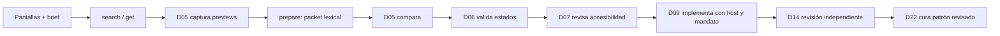

# Handoff — Biblioteca visual y pantallas PXIL

## Propósito y alcance

Este flujo permite que un perfil tome un brief con varias pantallas, compare referencias
de la biblioteca propia y 21st, registre previews y prepare un handoff por pantalla. No es
un constructor automático ni una aprobación. La consola refleja registros reales, pero no
demuestra que un agente ejecutó una acción fuera del SDK.

`VILTRUM DESING` es el origen de los materiales de PXIL. El runtime usa los perfiles del
SDK y la instantánea portable `.viltrum/os` del proyecto; no depende de esa carpeta externa
para ejecutar. La instantánea acotada ya importada tampoco equivale a integrar los 16
repositorios vendor clonados: no afirmamos que estén conectados, instalados o activos.

## Flujo operativo

El encargado proporciona `pantallas.json` con `name`, `stack` y todas las pantallas. Cada
pantalla incluye `id`, `name`, `purpose`, `components` y `states`; usar
[`templates/design-brief.example.json`](../../templates/design-brief.example.json) como
ejemplo. En el proyecto autorizado:

```powershell
viltrum design PROJECT brief --file pantallas.json
viltrum design PROJECT status
viltrum design PROJECT search --query "necesidad concreta" --limit 8
viltrum design PROJECT acquire --id ID
viltrum design PROJECT capture --id ID --file preview.png --actor ACTOR --kind provider_preview
viltrum design PROJECT prepare --brief-id BRIEF_ID
viltrum design PROJECT status
```



`search` consulta metadatos de biblioteca y la fuente oficial 21st según acceso disponible,
con límite acotado. Las búsquedas pueden no tener costo según el skill del proveedor, pero
siguen sujetas a cuotas: verificar el límite vigente antes de planificar consultas repetidas.
Si se recibió una respuesta previa como JSON, `import-search --file resultados.json`
la incorpora en vez de repetir la consulta. `acquire` recupera un componente con el método
oficial y archiva texto bajo `.viltrum/design/`; el contenido es código fuente no ejecutado.
La adquisición no instala dependencias ni licencia el componente. La captura se toma con un
navegador real desde el preview oficial, usando pestaña propia; después se registra mediante
`capture` con actor y tipo. No capturar masivamente.

## Handoff por todas las pantallas

El brief sirve de inventario completo del lote. `prepare` genera un plan lexical que conserva
cada pantalla y sus estados declarados y adjunta candidatos disponibles. Su ranking no es
inteligencia visual, QA ni prueba de que los candidatos cubran los estados solicitados; un
resultado vacío tampoco demuestra que el catálogo carezca de un componente adecuado. Los
vacíos se reportan pendientes; no se completan por inferencia. D05 inspecciona previews y
capturas manualmente.

El contexto runtime enlaza el brief más reciente y el plan/packet más reciente asociado a ese
brief, y solo los adjunta en encargos clasificados `CAMBIO_UI` o etapa F3. Esto no activa
perfiles ni fuerza una ruta: D00/host confirma la fase, alcance y mandato reales.
Antes de implementar, el equipo de perfiles completa por pantalla el ciclo PXIL:

| Responsable | Entrega |
|---|---|
| D21 | Candidatos, URL/autor/ID, dependencias, licencia/procedencia y compatibilidad |
| D05 | Tokens, receta, capturas comparativas y selección recomendada |
| D06 | Estados/transiciones/eventos, permisos, datos, feedback y recuperación |
| D07 | Revisión semántica, teclado, foco, contraste y zoom |
| D09 | Implementación solo con mandato y alcance vigentes |
| D14 | Revisión independiente de resultado y evidencia |
| D22 | Promoción a biblioteca solo del patrón revisado y dentro de su alcance |

Registrar el razonamiento y evidencia en `templates/pxil-component-evaluation.md`. Una
captura acredita solo viewport/estado observado. El plan no crea mandato, C1, aceptación,
review ni gate; no sobrescribe configuración global ni altera otros proyectos. Para trabajo
interno autorizado aplica su mandato; trabajo de cliente respeta el gate C1 comercial vigente.

La ruta local determinista no requiere conexión de modelo. Jev remoto es solo una opción
conceptual: no declarar proveedor/API, entrada de imagen, soporte, autenticación ni salida
hasta verificarlos con documentación oficial y configurar explícitamente una integración.
El ranking, local o remoto, nunca sustituye la decisión del responsable ni la revisión humana.

## Límites operativos

SDK 0.6 mantiene una biblioteca curada de hasta 500 componentes por proyecto y admite
hasta 30 pantallas por brief. Esto no indexa ni evalúa visualmente todo el catálogo de
21st. Las búsquedas remotas recuperan candidatos; la búsqueda de la galería es local.
Los perfiles comparan las capturas disponibles y documentan compatibilidad, licencia,
estados y selección antes de incorporar código.

Operación realizada en `E:/PERFILES AI`: tres candidatos oficiales (14941, 28770, 31454),
código de 14941 adquirido, dos previews registrados y un brief de ejemplo con dos
pantallas. La consola respondió por `/api/design` y sirvió capturas JPEG verificadas por
SHA256. Se inspeccionó la galería en el navegador; no se ejecutó una suite de pruebas.
El ejemplo no es una propuesta aceptada ni una entrega final al cliente.

Las búsquedas de biblioteca deben usar endpoints GET de solo lectura. Las consultas al
catálogo 21st van por su CLI/MCP oficial; sin acceso, registrar el bloqueo y continuar con
biblioteca local. No scraping, instalación automática, ejecución del código recuperado,
compra implícita, carga de capturas privadas a un modelo ni promoción automática.
