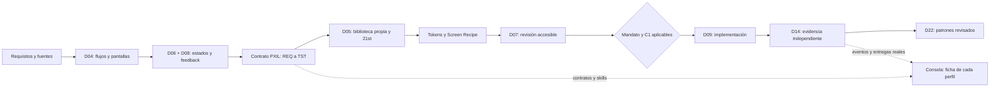

# Handoff para Claude Code — PXIL y 21st

Fecha: 2026-09-30. SDK: 0.5.0. Cambio solicitado por el usuario sobre la consola operativa.

## Implementado

- CLI oficial de 21st: `init --design-context`, búsqueda con contexto, `get 14941 --json`
  y revisión determinista de `templates/dashboard.html`.
- Referencia elegida: [Dashboard Sidebar, arunjdass](https://21st.dev/@arunjdass/components/dashboard-sidebar).
  Se adaptó el patrón a HTML/CSS/JS existente: navegación contraíble, jerarquía visual,
  directorio de agentes en tarjetas, inspector persistente y ficha de recursos PXIL.
  No se instaló React ni se distribuyó código del componente recuperado. La consulta local
  está en `output/21st/`; decisión y tokens en `.21st/design.json`.
- Recursos de `E:\VILTRUM\VILTRUM DESING`: snapshot acotado de 27 archivos, incluyendo
  13 schemas, 7 skills originales y documentos PXIL. Hashes de fuente y copia en
  `integrations/pxil/provenance.json`. No se ejecutaron ni duplicaron los 16 repositorios clonados.
- Skill nueva `viltrum-pxil-design`: conecta esos procedimientos con fases/revisores Viltrum.
- Contratos D04/D05/D06/D07/D08/D09/D14/D21/D22 incluyen `supporting_skills`.
  `runtime._prompt` carga realmente sus instrucciones, tanto para productor como revisor.
  `console.py` expone skills y `designResources`; no convierte referencias en permisos.
- Plantilla `templates/pxil-experience-contract.md` y catálogo `registry/design-resources.json`.
- Copias locales raíz/demo: se actualizaron contratos coincidentes y añadieron recursos;
  se conservaron cinco AGENTS.md del demo que ya diferían. El runtime lee el contrato actualizado.
- Los nueve workspaces `.clawd/viltrum/workspaces/` reciben `PXIL.md` como pack metodológico.
  OpenClaw conserva la política sin tools y sus bloqueos previos; no se acredita ejecución nueva allí.

## Distribución por perfil

| Perfil | Aporte PXIL | Entrega |
|---|---|---|
| D04 UX | Experience Contract | Flujos, tareas y pantallas trazables |
| D05 UI | Compose, 21st Scout, Visual QA, Library Curation | Tokens, receta, componentes y procedencia |
| D06 Estados | Experience Contract, Permission Matrix | Estado/evento/permiso/feedback/recuperación |
| D07 Accesibilidad | A11y QA, Permission Matrix | Semántica, teclado, foco y acceso |
| D08 Contenido | Experience Contract | Mensajes y feedback por estado |
| D09 Frontend | Compose | Implementación de la receta con contrato vigente |
| D14 QA | Visual QA | Evidencia y hallazgos independientes |
| D21 Investigación | 21st Scout | Candidatos, compatibilidad y procedencia |
| D22 Conocimiento | Library Curation | Patrones revisados y memoria |

## Mecanismo



## Límites comprobados

El `pxil/scripts/traceability-linter.js` original es un mock que imprime éxito sin
inspeccionar entradas. No fue importado ni puede usarse para aprobar trazabilidad.
Los schemas comprueban estructura cuando se ejecuta un validador compatible; no
prueban por sí solos que los enlaces REQ→TST sean completos.

XState, Storybook, Onlook, Playwright y axe requieren instalación/conexión por proyecto.
Los gates PXIL se nombran PXIL-G0..G8; nunca equivalen automáticamente a los de Viltrum.
No hay fine-tuning ni evaluación de pericia al 100%. Hay instrucciones, contratos y recursos.
La revisión 21st es estática y no sustituye auditoría de accesibilidad ni pruebas de todos los estados.

## Continuar y reproducir

```powershell
py tools/import_pxil.py 'E:\VILTRUM\VILTRUM DESING'
py tools/connect_pxil_profiles.py
py tools/sync_sdk_data.py
.\start-viltrum.ps1
```

El importador conserva cambios locales desconocidos y registra SHA256; no copia credenciales
ni mcp_config.json. Revisar las fuentes antes de aceptar actualizaciones del pack.
Para otros proyectos, instalar SDK 0.5.0 y `viltrum install RUTA`; las copias ya existentes
del núcleo son deliberadamente conservadas y requieren migración explícita.

El funcionamiento anterior del webhook/Codex y bloqueos de Docker/OpenClaw están en
[HANDOFF-CONSOLE-CLAUDE-CODE.md](HANDOFF-CONSOLE-CLAUDE-CODE.md).

## Ciclo visual ejecutado con subagentes

- `design_visual_scout`: cinco capturas de dos referencias oficiales de 21st y comparación.
- `pxil_contract_reviewer`: revisión estática del pack y plantilla de evaluación visual.
- `console_visual_reviewer`: capturas del panel desktop/móvil y revisión independiente.
  Detectó nombres accesibles ausentes en navegación compacta y selección no anunciada;
  ambos se corrigieron y fueron revalidados por ese mismo revisor.
- `docs/research/21st/visual-evidence.json`: hashes, dimensiones, origen, actor y alcance.
- `output/design-review/index.html`: comparación visual local de referencias y resultado.
- La skill integradora ahora prescribe scout → captura → contrato → implementación →
  revisión → memoria, con pestañas propias, evidencia por viewport y límites explícitos.
- El conector conserva skills ajenas y actualiza copias gestionadas por hashes;
  recursos/plantillas PXIL entran en huellas del runtime. Los schemas dentro del proyecto
  se añaden al contexto de encargos PXIL. No hay evaluación semántica automática REQ→TST.
