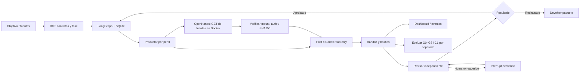

# Handoff: runtime durable de Viltrum — SDK 0.3

Fecha: 2026-09-29. Mandato: `M-runtime-funcional-2026-09-29.md`.

## Qué se incorporó

El SDK 0.2 preparaba planes; el SDK 0.3 añade ejecución durable con LangGraph,
SQLite, prompts por contrato, entregas/handoffs y revisión independiente. Mantiene
23 perfiles, fases y aceptación comercial C1 como autoridad de Viltrum.

| Pieza | Función | Integración |
|---|---|---|
| LangGraph 1.2.12 | Estado, pasos, interrupciones y reanudación | Dependencia opcional `runtime`; saver SQLite 3.1.1 |
| Codex CLI | Productor/revisor de análisis en procesos distintos | Adaptador local read-only, salida JSON, actor por proceso |
| Host | Usa tools y subagentes disponibles en Codex/Claude | Prompt → entrega real → `run-submit` → revisión → `run-review` |
| OpenHands Agent Server 1.50.0 | Workspace Docker con proyecto en solo lectura | Servicio local 8011, autenticación y mount comprobados; adaptador GET con hashes |
| `openhands-codex` | OpenHands aporta contexto, Codex produce y revisa | Backend explícito; sin clave LLM OpenHands ni conversaciones remotas; comprobar cada run |
| `openhands` | Conversaciones propias de Agent Server | Adaptador incluido; bloqueado por falta de modelo/clave LLM explícitos, no ejecutado |
| SwarmClaw | Interfaz/delegación alternativas | Bundle portable existente ampliado con skills de runtime; instancia pendiente |
| OpenClaw | Interfaz/tools del host | Opción investigada, servicio no conectado en este SDK |
| Git/Obsidian | Código, decisiones y conocimiento | Artefactos Markdown existentes; sin duplicar autoridad de estado |

MetaGPT aporta SOP/roles; CrewAI ofrece colaboración/Flows; mini-SWE aporta un
ejecutor pequeño para issues. Se documentan sus APIs/licencias y compatibilidad;
no se instalan juntos con LangGraph. CrewAI/MetaGPT requieren entornos Python
separados de este Python 3.14 según versiones investigadas.

## Mecanismo

Fuente → clasificación D00 → perfil productor → entrega con hashes → revisor
canónico independiente → siguiente perfil. LangGraph conserva un `thread_id`
por run, pausas y checkpoints. Terminar el run significa entregas revisadas; los
gates y C1 exigen su evaluación/aprobación separada. D00 no produce código de producto.



Fuente ampliada: `diagramas/14-runtime-durable.mmd`. Complementa los diagramas
10/11 de SwarmClaw y 13 de orquestación global. SwarmClaw/OpenClaw conservan
conexiones opcionales; OpenHands local sí expone el workspace verificado.

## Archivos de implementación

- `viltrum_sdk/runtime.py`: grafo, locks, checkpoints, prompts, validación de hashes,
  interrupciones, entrega y revisión del SDK.
- `viltrum_sdk/executors.py` y `adapters/controlled.py`: puerto de ejecución,
  disponibilidad/autenticación, proceso read-only y resultado estructurado.
- `adapters/openhands.py`: cliente local, comprobación Docker/API, contexto GET
  con SHA256 y backend híbrido; conversaciones propias pendientes de credencial LLM.
- `integrations/openhands/`: Compose con imagen por digest, setup PowerShell y guía.
- `viltrum_sdk/cli.py`: run/runs/status/resume/submit/review/cancel, lectura HTTP.
- `templates/dashboard.html`: etapas, 23 perfiles, ejecuciones, salida y eventos.
- `registry/runtime.json`: motores, versiones, alcance y conexiones declaradas.
- `skills/viltrum-runtime` / `viltrum-runtime-review`: operación y revisión.
- `skills/orquestar`, `core/orchestration.md`, `CLAUDE.md`: entrada global actualizada.
- `pyproject.toml`: SDK 0.3 y extras; paquete base conserva cero dependencias.

El snapshot `viltrum_sdk/data` se genera con `tools/sync_sdk_data.py`. El installer
conserva archivos existentes; no asumir que una instalación antigua se actualizó.
Los proyectos de clientes no se migran por actualizar el paquete Python.

## Uso

Desde la copia local autorizada:

```powershell
py -m pip install -e 'E:\PERFILES AI[runtime]'
py -m viltrum_sdk.cli setup-global
py -m viltrum_sdk.cli runtime-doctor
```

Desde un proyecto con Viltrum instalado:

```powershell
viltrum run . --goal "Investigar requisitos y siguiente paso" --intent INVESTIGACION --backend codex
viltrum runs .
viltrum run-status . --run-id RUN-ID
viltrum dashboard . --port 8765
```

Para usar el workspace OpenHands de la demostración local:

```powershell
$env:VILTRUM_CODEX_TIMEOUT_SECONDS='420'
py -m viltrum_sdk.cli run 'E:\PERFILES AI\tmp\runtime-demo' --goal "D21 compara README.md y docs/motores.md usando el contexto del workspace" --intent INVESTIGACION --backend openhands-codex
```

El mount y `client.json` deben corresponder exactamente al proyecto solicitado.
Consultar `integrations/openhands/README.md` antes de montar otro proyecto. El
backend global `codex` funciona sin ese servicio. `openhands-codex` recibe archivos
seleccionados por el supervisor, separados como datos del prompt; no presupone que
el modelo abrió esos archivos mediante herramientas. `sourceEvidenceCount` cuenta
referencias del modelo y `supervisorSourceCount` las entradas suministradas con hash.

Usa `py -m viltrum_sdk.cli` si la terminal tiene un PATH antiguo. Para aprovechar
tools del host: `--backend host`, lee el prompt de `run-status`, delega realmente y
registra `run-submit ... --actor SESION --summary salida.md --evidence fuente.md`.
Después, otro actor revisa y registra `run-review ... --result approved|rejected
--report revision.md`. No inventar una sesión o aceptación humana.

Persistencia: `.viltrum/runtime/checkpoints.sqlite` y `runs/RUN-.../{run.json,
events.jsonl,prompts/,artifacts/}`. Los handoffs/revisiones siguen el SDK existente.
`run-resume` usa el mismo ID; cambios en entradas/políticas/artefactos invalidan la
continuación. Un despacho interrumpido no se reejecuta silenciosamente. `run-cancel`
cancela el futuro trabajo, conserva evidencia y no revierte efectos ya emitidos.

## Límites reales

- Primera versión ejecuta análisis/documentación, no construcción de producto.
- Codex instalado/autenticado no acredita aislamiento: se exige read-only y se
  registra lo observado al ejecutar. Ningún fallback elimina el sandbox.
- OpenHands local: imagen oficial por digest, rootfs/proyecto read-only, usuario10001,
  caps eliminadas, sin docker.sock ni home del host, puerto loopback8011. Credenciales
  fuera del repositorio. `/tmp` ejecutable permite arrancar PyInstaller; red saliente
  disponible. Esto no acredita aislamiento universal ni impide lectura de cualquier
  archivo interno si alguien usa directamente el API fuera del adaptador.
- `openhands-codex` mantiene Codex en el host con sandbox read-only; solamente la
  lectura supervisada del workspace usa Docker. No llamarlo Codex dentro de Docker.
- Claude Code está instalado pero su autenticación debe acreditarse antes de usarlo
  como ejecutor. Las skills globales no autentican servicios.
- Actores/humanos son declaraciones del host; no hay SSO ni firma de identidad.
- 23 contratos/SOPs existen, `eval_score` conserva null: falta evaluar su pericia.
- No se instaló una colección externa de skills sin revisión. El mapa de capacidades
  por perfil y fuentes aparece en `docs/research/skills-agencia-2026-09-29.md`.

## Evidencia y continuidad

Consultar `verificacion-runtime-2026-09-29.md` para ejecuciones efectivamente operadas,
IDs, revisión, archivos y bloqueos observados. No tomar el diseño como evidencia de
ejecución. Investigación independiente en `docs/research/motores-agencia-2026-09-29.md`,
`ejecucion-controlada-2026-09-29.md` y `skills-agencia-2026-09-29.md`.

Caso real finalizado: `RUN-6045c280de784f119411b4a1d6938cb2` / HND-004, D21→D03
con backend `openhands-codex`, fuentes2/5 suministradas por el supervisor y revisión
aprobada para síntesis documental. Sin conversaciones LLM OpenHands ni gates/C1.
La auditoría independiente y el receipt del wheel final permanecen en
`docs/research/revision-cli-panel-2026-09-29.md` y `output/sdk-wheel/` respectivamente.

Siguientes capacidades: evaluar pericia de cada perfil, conectar tools/CI por proyecto
y medir costo/observabilidad. El ejecutor OpenHands con LLM propio requiere configurar
y probar proveedor explícito. Construcción, despliegue y aceptación del cliente
mantienen permisos/gates explícitos.
