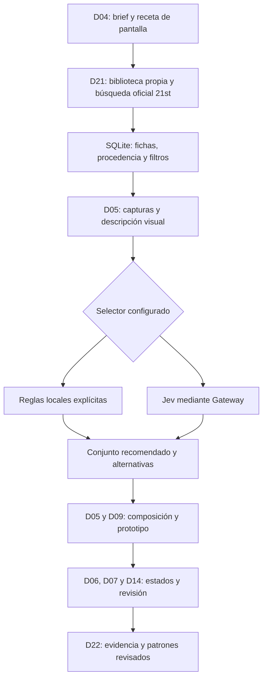

# Jev, json-render y selección de componentes PXIL

Fecha: 2026-09-30. Estado: propuesta investigada; no instalada ni conectada.
Participaron subagentes económicos: jev_vercel_integration, free_design_tools y research_jev.

## Decisión propuesta

Base local: catálogo SQLite FTS5, contratos PXIL y capturas/revisión de componentes.
Jev será un selector opcional detrás de un contrato propio. Comparar su utilidad contra
la selección local antes de hacerlo parte del flujo habitual. No convertir una probabilidad
del modelo en aprobación de diseño o gate.

Jev es el modelo de TypeSafe AI; Vercel AI Gateway es una vía de acceso al mismo modelo.
json-render es un proyecto distinto para componer/renderizar interfaces declarativas.
No hacen falta dos Jev. [Modelo](https://vercel.com/ai-gateway/models/jev).

Jev 1.13 acepta solo texto/JSON; no imágenes. Un agente con visión debe convertir
capturas en observaciones estructuradas antes de la evaluación. La interpretación visual
conserva sus incertidumbres y evidencia original. [Modalidades oficiales](https://docs.typesafe.ai/models).

La integración de composición de json-render está marcada experimental y aún no publicada:
requiere build desde un checkout y registrar commit/versiones exactas. Ofrece candidatos
concretos; devuelve una especificación compuesta. No inventa el contenido de las opciones.
El evaluador y sus credenciales permanecen en servidor. [Guía](https://json-render.dev/docs/jev).

## Flujo propuesto

Cada candidato registra ID, versión, procedencia/licencia, stack, dependencias, función,
familia visual, tokens, estados observados, capturas y hash. Cada decisión registra receta,
lista admisible, criterios, selector/modelo, IDs elegidos, puntuaciones con semántica explícita,
pendientes, duración, consumo si está disponible y revisión independiente.

Filtrar primero por requisitos obligatorios. Un dato desconocido sigue desconocido.
El piloto propuesto usa 30–50 fichas curadas, 10–20 candidatos por pantalla, 3–6 previews
y 2–3 composiciones. Son límites de diseño del piloto, no límites del proveedor.
La expansión del catálogo será por categorías y canales oficiales, sin afirmar cobertura
exhaustiva de 12.000 elementos a partir de búsquedas parciales.

## Encaje con el SDK actual

Existe: skills PXIL, contratos de nueve perfiles, schemas, captura mediante subagentes,
plantilla de evaluación y dashboard de lectura. No existe aún adaptador Jev ni biblioteca consultable.

Archivos propuestos:

- `viltrum_sdk/design_catalog.py`: fichas, índice, versiones y evidencia.
- `viltrum_sdk/selectors/local.py`: ordenación local declarada como tal.
- `viltrum_sdk/selectors/jev.py`: acceso opcional a evaluación remota.
- `schemas/design-selection.schema.json`: contrato común y resultados incompletos.
- `integrations/json-render/`: laboratorio de composición separado, si el piloto lo justifica.
- `console.py` y dashboard: galería, filtros, comparación, origen y estado de evaluación.

Para evaluar opciones puede mantenerse Python y usar una API documentada del proveedor.
Vercel documenta evaluación y una interfaz compatible TypeSafe; para código nuevo recomienda
la API de evaluación. La vía directa TypeSafe sería una alternativa de transporte al mismo
modelo y necesitaría su propia configuración, no una segunda capacidad de diseño.
[API Gateway](https://vercel.com/docs/ai-gateway/sdks-and-apis/typesafe).
Si se adopta el compositor json-render, conviene un módulo TypeScript separado que reciba
JSON del SDK y devuelva JSON validado. Mantener el panel HTML actual durante el piloto.
La clave Gateway se configura únicamente en el proceso servidor; sin llamadas remotas desde
el navegador ni cambios automáticos de proveedor. Registrar timeout, fallo, límites y caché
por versión de receta/candidatos. No activar facturación ni transmitir documentos del cliente
como parte de esta investigación.

## Componentes gratuitos o abiertos priorizados

| Pieza | Papel | Licencia / límite |
|---|---|---|
| [SQLite FTS5](https://www.sqlite.org/fts5.html) | Recuperación local por texto y filtros | SQLite dominio público; no es búsqueda visual/semántica |
| [Storybook](https://github.com/storybookjs/storybook) | Laboratorio local de componentes y estados | MIT; servicios cloud como Chromatic son aparte |
| [Playwright](https://github.com/microsoft/playwright) | Capturas e interacciones repetibles | Apache-2.0; requiere navegador/recursos locales |
| [axe-core](https://github.com/dequelabs/axe-core) | Comprobaciones automáticas de accesibilidad | MPL-2.0; revisión manual sigue necesaria |
| [json-render](https://github.com/vercel-labs/json-render) | Composición/render declarativo | Apache-2.0; consumo Jev se cobra aparte |
| [Ollama](https://github.com/ollama/ollama) | Inferencia local opcional | Runtime MIT; hardware y licencia de cada modelo por separado |

CUA-JEV y jev-browser no son dependencias necesarias de esta propuesta: ya tenemos captura
y navegación, y el problema principal es recuperar, comparar y componer componentes.

## Coste y salida del piloto

Jev remoto no se debe presentar como gratuito ilimitado. Gateway tiene créditos gratuitos
condicionados a elegibilidad de modelos/cuenta y cobro por consumo; comprobar disponibilidad
antes de configurar. [Precios oficiales](https://vercel.com/docs/ai-gateway/pricing).

Medir utilidad con tareas de diseño representativas: cumplimiento de requisitos, proporción
de propuestas aceptadas por un revisor independiente, defectos, tiempo y coste por decisión.
Retirar el selector remoto si no mejora el resultado o esfuerzo de revisión frente a la base local.
No se han ejecutado esas mediciones, pruebas ni llamadas a Jev en este trabajo.
