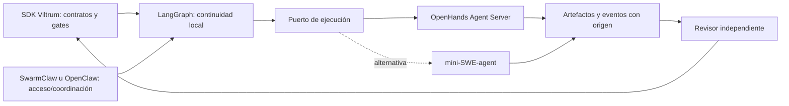

# Motores de agencia para Viltrum Agentic OS

**D21 · Consulta: 2026-09-29 · Revisión requerida: D03/D12.**
Estado: investigación documental con lectura de metadatos locales. Este expediente
no acredita instalaciones externas, llamadas a modelos ni tareas ejecutadas por ellos.
La investigación solo modificó este archivo; no utilizó credenciales ni envió datos
privados a las fuentes consultadas.

## Capacidad y criterio de adopción

Viltrum necesita ejecutar entregables de sus departamentos, conservar el punto de
continuación tras reinicio, esperar revisión real y reconciliar tareas externas sin
duplicar efectos. El resultado debe enlazar proyecto, departamento, gate, actor,
artefactos y ejecución. Los contratos/gates del SDK conservan autoridad sobre la
aceptación; completar una conversación externa aporta evidencia de ejecución.

Restricciones: Windows local, SDK Python con núcleo sin dependencias, entorno
`.venv-langgraph` separado, proveedor configurable, secretos fuera de Git y permisos
limitados por tarea. Volumen, presupuesto y proveedor de modelos no están definidos.
Las operaciones sobre producción conservan la autorización humana de `CLAUDE.md`.

Se aplicó `skills/viltrum-research/SKILL.md`. La solicitud exige una tabla real sin
inventar puntuaciones: se documentan hechos, inferencias y pruebas pendientes. El
scoring ponderado de D21 y la aprobación final de adopción quedan pendientes de
mediciones; ningún total numérico se deduce de estrellas o afirmaciones de README.

## Lo existente y los cuatro frentes

| Frente | Evidencia y decisión |
|---|---|
| Interno | `core/orchestration.md` ya define contexto, etapas, contratos, handoff y revisión. El SDK/panel y `integrations/swarmclaw/` ya cubren doctrina/proyección/exportación; conservarlos evita reconstruir gobierno. |
| Nativo | `sqlite3` de Python ofrece transacciones locales, pero por sí solo exige implementar replay, interrupciones y esquema de checkpoints. Aprovechar el saver oficial evita crear otro motor de continuidad. |
| Open source | Se comparan LangGraph, OpenHands, SwarmClaw, OpenClaw, MetaGPT, CrewAI, SWE-agent y mini-SWE-agent abajo, con licencias/versiones. |
| SaaS/API | Las ofertas gestionadas de LangSmith/OpenHands/CrewAI existen en sus fuentes, pero no se contrataron ni se compararon precios: la capacidad solicitada es local y no hay presupuesto/retención de datos acordados. REST local sí es un puerto de integración pertinente. |

Observación local de esta investigación: `.venv-langgraph/pyvenv.cfg` declara Python
`3.14.2`. Los directorios de metadatos mostraron `langgraph 1.2.12`,
`langgraph-checkpoint 4.2.0`, `langgraph-prebuilt 1.1.0`, `langgraph-sdk 0.4.5` y
`langchain-core 1.6.6`. No se observó el saver SQLite en esa lectura inicial; la
instalación del runner puede cambiar después. Estos datos no equivalen a un import o
una prueba del runtime.

## Comparación de funciones y restricciones

Las capacidades de esta tabla son declaraciones en fuentes primarias. El encaje y
la prioridad son inferencias arquitectónicas; no resultados de benchmark Viltrum.

| Base y licencia consultada | Aporte concreto | Función en Viltrum y adopción | Restricción / solapamiento |
|---|---|---|---|
| [LangGraph](https://github.com/langchain-ai/langgraph), [MIT](https://github.com/langchain-ai/langgraph/blob/main/LICENSE) | Grafo de estado, checkpoints, interrupciones y continuación por thread. | **Ahora:** motor local de continuidad detrás del puerto propio; E1 biblioteca + E3 patrón oficial. | No provee por sí mismo sandbox, modelo, identidad de revisor ni validación de gates. Memoria RAM no sobrevive a reinicio. |
| [OpenHands Software Agent SDK](https://github.com/OpenHands/software-agent-sdk/tree/v1.50.0), [MIT](https://github.com/OpenHands/software-agent-sdk/blob/v1.50.0/LICENSE) | Agentes que usan terminal/editor, conversaciones persistibles y Agent Server con API REST/WebSocket. | **Ahora como ejecutor configurable:** adaptador de conversación; E1 integración del SDK/servidor externo. | Tiene su propio estado de conversación. Persistir su ID además del checkpoint; aislar herramientas/workspace. Paquetes actuales exigen Python ≥3.12. |
| [OpenHands Agent Canvas](https://github.com/OpenHands/OpenHands/tree/v1.24.0), [MIT](https://github.com/OpenHands/OpenHands/blob/v1.24.0/LICENSE) | Consola visual y elección de backends. | **Opcional:** operación humana del ejecutor. | El repo `OpenHands/OpenHands` ahora corresponde a Canvas; SDK/Agent Server vive en otro repo. La automatización también tiene repositorio separado. Canvas agrega otra consola. |
| [SwarmClaw](https://github.com/swarmclawai/swarmclaw/tree/v1.9.40), [MIT](https://github.com/swarmclawai/swarmclaw/blob/v1.9.40/LICENSE) | Agentes, tareas, delegación, memoria, MCP y proveedores/CLI. | **Ahora como coordinación opcional:** aprovechar bundle/IDs del adaptador existente; E1 plataforma externa. | El bundle local no prueba conexión. Requiere importación y reconciliación; no dejar que `done` apruebe un gate. También puede ejecutar, por lo que hay que elegir un único dueño del despacho. |
| [OpenClaw](https://github.com/openclaw/openclaw/tree/v2026.9.6), [MIT](https://github.com/openclaw/openclaw/blob/v2026.9.6/LICENSE) | Gateway, routing de agentes/sesiones, canales y skills. | **Ahora como alternativa o gateway opcional:** entrada/coordinar sesiones; E1 externo detrás de adaptador. | Routing de sesiones no es el workflow de gates. SwarmClaw y OpenClaw necesitan responsabilidad explícita: un gateway puede ser acceso, el otro dueño de tareas; evitar doble despacho. |
| [MetaGPT](https://github.com/FoundationAgents/MetaGPT), [MIT](https://github.com/FoundationAgents/MetaGPT/blob/v0.8.1/LICENSE) | Roles de compañía de software, SOP, generación de repositorio y Data Interpreter. | **Referencia:** estudiar SOP y artefactos; E4 diseño guiado por referencia. PoC aislada solo si hay necesidad. | Se solapa con los 23 contratos Viltrum; puede generar una segunda organización. Paquete exige Python ≥3.9,<3.12 y muchas dependencias antiguas fijadas. Última release GitHub y paquete PyPI difieren. |
| [CrewAI](https://github.com/crewAIInc/crewAI/tree/1.15.23), [MIT](https://github.com/crewAIInc/crewAI/blob/1.15.23/LICENSE) | Crews con roles/tareas y Flows con control por eventos/estado. | **Alternativa:** un crew acotado dentro de un nodo si resuelve un entregable medible; E1 externa. | Flows compite con LangGraph como coordinador de estados. PyPI excluye Python 3.14; necesita entorno separado. Memoria/vectorización/telemetría agregan dependencias. |
| [SWE-agent](https://github.com/SWE-agent/SWE-agent/tree/v1.1.0), [MIT](https://github.com/SWE-agent/SWE-agent/blob/v1.1.0/LICENSE) | Ejecución para resolver issues con entorno/herramientas configurados. | **Referencia histórica / reproducción:** no primera integración nueva. | El README oficial recomienda mini-SWE-agent como sucesor. No instalar por inferencia `sweagent` de PyPI: el nombre consultado publicó 0.0.1, distinto de la release 1.1.0. |
| [mini-SWE-agent](https://github.com/SWE-agent/mini-swe-agent/tree/v2.4.6), [MIT](https://github.com/SWE-agent/mini-swe-agent/blob/v2.4.6/LICENSE.md) | CLI y agente de código pequeño, con configuración y entornos reemplazables. | **Alternativa al ejecutor:** entrega acotada de corrección; E1 proceso separado. | Se solapa con OpenHands en ejecución de código. La sencillez del loop no acredita sandbox o permisos Viltrum. Comparar mismo issue y mismas restricciones antes de sustituir. |

El aviso del mantenedor sobre SWE-agent aparece en su
[README oficial](https://github.com/SWE-agent/SWE-agent#readme). La delimitación
actual de OpenHands se documenta en
[Agent Canvas](https://github.com/OpenHands/OpenHands#repository-boundaries) y
[SDK](https://github.com/OpenHands/software-agent-sdk#repository-boundaries).
Las licencias MIT de los repositorios no asignan licencia automáticamente a modelos,
datos, extensiones o dependencias transitivas: conservar avisos y revisión D12 de los
artefactos efectivamente utilizados. En OpenClaw, la API de GitHub informó
`NOASSERTION`; el texto `LICENSE` de la versión fijada y `package.json` declaran MIT.

## Versiones y procedencia reproducible

Consulta directa a GitHub REST (releases/commits), archivos del tag y JSON oficial
de PyPI. Los pins son candidatos reproducibles; la compatibilidad conjunta requiere
la prueba indicada más abajo. No usar `releases/latest` del monorepo LangGraph como
versión de la librería: esa respuesta correspondía al CLI, `cli==0.4.32.dev0`.

| Componente | Pin propuesto / observado | Requisito y fuente |
|---|---|---|
| LangGraph | `langgraph==1.2.12` | Python ≥3.10. [PyPI de versión](https://pypi.org/pypi/langgraph/1.2.12/json). |
| Checkpoints | `langgraph-checkpoint==4.2.0`, `langgraph-checkpoint-sqlite==3.1.1` | Ambos compatibles por restricciones declaradas `checkpoint>=4.1,<5`; saver necesita `aiosqlite>=0.20`, `sqlite-vec>=0.1.6`. [SQLite PyPI](https://pypi.org/pypi/langgraph-checkpoint-sqlite/3.1.1/json). |
| Resto LangGraph | Lock del entorno observado: core `1.6.6`, prebuilt `1.1.0`, sdk `0.4.5` | Fijar transitivas tras resolver/importar; consultar metadata del pin. El `langgraph-sdk` Python no instala un Agent Server por estar presente. |
| OpenHands ejecutor | `openhands-sdk==1.50.0`, tools/workspace/agent-server de la misma serie `1.50.0` si necesarios | SDK/tools/workspace consultados: Python ≥3.12. [SDK PyPI](https://pypi.org/pypi/openhands-sdk/1.50.0/json). Tag `v1.50.0`, SHA `dcf401af7a9a302ef92cb7d092e1df9bb659daa5`. |
| OpenHands Canvas | `v1.24.0`, SHA `7dc6805406ea3c76cb4a3ce407c3c72d481b0ac6` | README exige Node ≥24 y `uv`; Docker Desktop para opción sandbox. No confundir versión Canvas con SDK. |
| SwarmClaw | `v1.9.40`, SHA `ed38ba5329c20e48c03b4a4028f4a76a1a75e2d1` | [package.json](https://github.com/swarmclawai/swarmclaw/blob/v1.9.40/package.json): Node ≥22.6.0. Coincide con commit evaluado en la arquitectura local. |
| OpenClaw | `v2026.9.6`, SHA `eb377ac59e6c9fd6c7705028034812becf00271b` | [package.json del tag](https://github.com/openclaw/openclaw/blob/v2026.9.6/package.json): Node `>=24.16.0 <25 || >=26.1.0`; pnpm 12.4.0. Un requisito antiguo Node 22 no aplica al pin. |
| MetaGPT | PyPI `metagpt==0.8.2`; GitHub release `v0.8.1`, SHA `c036574507e7616c02512e7c8ad88dd847783afa` | [PyPI](https://pypi.org/pypi/metagpt/0.8.2/json): Python ≥3.9,<3.12. No tratar ambos artefactos como idénticos. |
| CrewAI | `crewai==1.15.23`, tag `1.15.23`, SHA `deaa71e168069a1d5307340172875def4330e75b` | [PyPI](https://pypi.org/pypi/crewai/1.15.23/json): Python ≥3.10,<3.14; core/cli `1.15.23` fijados por metadata. |
| SWE-agent | Tag `v1.1.0`, SHA `0f3acafacabc0def8cc76b4e48acb4b6cf302cb9` | [pyproject del tag](https://github.com/SWE-agent/SWE-agent/blob/v1.1.0/pyproject.toml): Python ≥3.11; usar fuente fijada para reproducción. |
| mini-SWE-agent | `mini-swe-agent==2.4.6`, SHA `a83fcae82d2a08f0ee0c688f9d137b3566c097f8` | [PyPI](https://pypi.org/pypi/mini-swe-agent/2.4.6/json): Python ≥3.10; loop/env/model separados. |

GitHub `pushed_at` observado: LangGraph, OpenHands y CrewAI 2026-09-29;
OpenClaw 2026-09-29; SWE-agent/mini 2026-09-28; SwarmClaw 2026-06-30;
MetaGPT 2026-01-21. Son señales de actividad del repositorio, no auditoría de
mantenimiento, resolución de vulnerabilidades ni garantía de soporte de una release.

## Patrón LangGraph que se integra primero

Fuentes: [checkpointers](https://docs.langchain.com/oss/python/langgraph/checkpointers),
[interrupciones](https://docs.langchain.com/oss/python/langgraph/interrupts),
[Graph API](https://docs.langchain.com/oss/python/langgraph/graph-api) y
[saver SQLite](https://github.com/langchain-ai/langgraph/tree/main/libs/checkpoint-sqlite).
Context7 se resolvió primero y se consultó `/langchain-ai/langgraph/1.0.8` para
el patrón base y `/websites/langchain_oss_python_langgraph` para semántica vigente.
El índice 1.0.8 no demuestra una API nueva de 1.2.12; se elige `invoke` como superficie
mínima y se contrasta con la documentación actual.

```python
from langgraph.checkpoint.sqlite import SqliteSaver
from langgraph.graph import StateGraph
from langgraph.types import Command, interrupt

# State y nodos pertenecen al adaptador; ejemplo de patrón, no runner completo.
def esperar_revision(state):
    respuesta = interrupt({
        "run_id": state["run_id"],
        "evidence": state["evidence"],
        "required_reviewer": state["required_reviewer"],
    })
    return {"review_response": respuesta}

config = {"configurable": {"thread_id": run_id_estable}}
with SqliteSaver.from_conn_string(ruta_db_local) as saver:
    graph = builder.compile(checkpointer=saver)
    result = graph.invoke(estado_inicial, config)
    # En otro proceso: reconstruir mismo grafo y abrir misma DB/thread.
    snapshot = graph.get_state(config)
    result = graph.invoke(Command(resume=respuesta_verificada), config)
```

La aplicación identifica el interrupt pendiente en `result["__interrupt__"]` o en
`snapshot.tasks`; invoca `Command(resume=...)` solo cuando existe uno. Recuperar un
run tras fallo pendiente usa `graph.invoke(None, config)` según el punto guardado;
un diccionario nuevo es nueva entrada, no respuesta a una pausa. `thread_id` debe
persistirse con la ejecución y repetirse al reanudar; un ID nuevo abre otro estado.
`get_state_history` permite inspección y `update_state` crea un checkpoint actualizado;
esas APIs tampoco constituyen aceptación de un gate.

El checkpoint se guarda en fronteras de supersteps. Al reanudar, el nodo que contenía
`interrupt` empieza otra vez: todo efecto previo debe ser idempotente. Mantener el
orden de interrupciones/tasks anteriores al punto guardado y evitar capturar
indiscriminadamente la excepción interna de interrupción. Separar nodos de
planificación, despacho, espera, revisión y registro de evidencia permite acotar replay.

Para un despacho OpenHands: generar clave estable, persistir intención/runId y
reconciliar antes de volver a crear una conversación. Un timeout tras POST tiene
resultado incierto: no equivale a ausencia de tarea. Ni SQLite ni LangGraph ofrecen
una transacción atómica con el proveedor externo. Se necesita protocolo de
reconciliación propio y operaciones idempotentes comprobadas en el adaptador.

Usar SQLite local para el primer runner con escritura serializada por thread. Para
multiusuario/múltiples procesos con carga, evaluar el saver Postgres y concurrencia
antes de migrar. `InMemorySaver` y `:memory:` solo sirven para ejemplos temporales.
Los datos compartidos entre threads pertenecen a Store, separados de checkpoints.
Guardar referencias/hash de artefactos y contexto mínimo evita serializar un repo o
todo el expediente. Conservar versión del grafo/esquema al lado del run.

El README actual del saver pide `LANGGRAPH_STRICT_MSGPACK=true` o lista explícita
`allowed_msgpack_modules` para restringir deserialización. Un checkpoint no debe
transportar secretos ni aceptarse desde una fuente no confiable. El modo de
durabilidad y las políticas de backup/retención deben fijarse al comprobar el pin;
la restauración de un archivo de DB requiere la copia consistente de SQLite.

## Contratos y separación de responsabilidad

Propuesta para D03: `RunState` guarda `project_id`, `run_id`, `department_id`,
`gate_id`, `task_key`, `executor`, `external_conversation_id`, `artifact_refs`,
`review_refs`, `graph_version` y error clasificable. Puerto ejecutor:
`submit`, `status`, `events`, `cancel`, `resume`, `collect_artifacts`; adaptador
traduce los proveedores. Productor y revisor tienen actores distintos registrados.
La respuesta de interrupt debe ser validada contra evidencia vigente y alcance;
un booleano `True` recibido no prueba identidad ni aprobación humana.

OpenHands `Conversation` permite persistir `conversation_id`, `persistence_dir`
y workspace y reconstruir la conversación. Está comprobado en
[ejemplo de persistencia v1.50.0](https://github.com/OpenHands/software-agent-sdk/blob/v1.50.0/examples/01_standalone_sdk/10_persistence.py).
El [router canónico v1.50.0](https://github.com/OpenHands/software-agent-sdk/blob/v1.50.0/openhands-agent-server/openhands/agent_server/conversation_router.py)
declara prefijo `/conversations`, creación POST, consulta GET por ID y POST de
`/{id}/run`, `/{id}/pause`, `/{id}/interrupt`. Escribir el adaptador contra OpenAPI
de la instancia/pin: no extrapolar endpoints `/api/conversations` del cloud o del
OpenHands antiguo al SDK actual. Autenticación y prefijos de montaje son parte del
servidor y necesitan comprobación real.



El diagrama expresa la arquitectura propuesta. Las conexiones disponibles deben
presentarse como configuradas, comprobadas o pendientes según evidencia del runner.

## Instalación mantenible y skills

La instalación pertenece a implementación. Mantener `.venv-langgraph` con un lock
propio y comando que invoque su Python absoluto; conservar extras fuera de
`pyproject.toml` del núcleo. Para OpenHands preferir Agent Server aislado con versión
de SDK/imagen y workspace explícitos, conexión de loopback y adaptador REST. Si se
usa SDK embebido, crear otro entorno y comprobar terminal/libtmux en Windows o
usar contenedor Linux. El código mínimo ejecutable no prueba aislamiento.

SwarmClaw/OpenClaw viven fuera del repo como servicios con almacenamiento/backup,
Node/npm/pnpm fijados y proveedores configurados por proyecto. Importar el bundle
una vez y guardar mapa de IDs; volver a importar no debe duplicar departamentos.
OpenClaw actual exige Node más reciente que SwarmClaw. MetaGPT y CrewAI requieren
entornos distintos del Python 3.14 observado; no agregarlos al mismo lock.

La [especificación Agent Skills](https://agentskills.io/specification) define
`SKILL.md` con frontmatter y recursos opcionales (`scripts/`, `references/`,
`assets/`), con carga gradual del detalle. Usarla como formato de portabilidad;
compatibilidad de descubrimiento/ejecución debe comprobarse en cada host.
Las skills Viltrum siguen describiendo procedimientos y contratos; no instalan una
herramienta ni crean permisos. Exportar por tarea solo las skills necesarias, con
procedencia y revisión de scripts externos. La selección de modelos/permisos queda
en configuración del runtime y mandato. ClawHub o marketplaces son fuentes de
candidatos; instalar automáticamente colecciones completas no tiene necesidad
demostrada aquí. OpenHands tiene ejemplos propios en
[skills y plugins](https://github.com/OpenHands/software-agent-sdk/tree/v1.50.0/examples/05_skills_and_plugins).

## Prueba acotada, costos y salida

Decisión recomendada para implementación inmediata: LangGraph local + saver durable,
puerto OpenHands configurable y coordinación SwarmClaw/OpenClaw opcional con dueño
único del despacho. Mantener CrewAI/MetaGPT como alternativas o referencias hasta
demostrar un entregable que mejore; mini-SWE-agent es alternativa específica al
ejecutor. D03 decide contratos; D12 revisa dependencias, secretos, acceso y licencias
antes de reutilizar piezas externas.

Prueba propuesta de un día, sin datos privados y con tarea reversible:

| Caso | Criterio de salida |
|---|---|
| Pausa/reinicio | Crear run, interrumpir, cerrar proceso, abrir DB y reanudar mismo thread; evidencia de checkpoints anterior/posterior. |
| Revisión | Respuesta rechazada conserva bloqueo; aceptación exige actor/evidencia válidos. Resultado externo `done` no cambia aprobación efectiva. |
| Despacho incierto | Simular corte después de crear conversación y antes de recibir respuesta; reconciliar un único ID y artefacto. |
| Runtime ausente | Error accionable y estado persistido; panel distingue proveedor pendiente de agente conectado. |
| Ejecutar realmente | Una conversación OpenHands autenticada escribe artefacto permitido en workspace aislado; recoger ID/log/diff sin secretos y handoff revisado. |
| Coordinación | Una sola tarea importada/despachada en versión fijada; IDs estables y recuperación tras desconexión. |

No se ejecutaron estas pruebas en investigación. D14 debe aportar evidencia de
implementación y D03 cerrar adopción; las puntuaciones de seguridad/cobertura/UX y
costos permanecen pendientes. Costo de licencia del código MIT: sin tarifa de
licencia de ese código. Costo a tres años: desconocido hasta fijar runs, tokens,
proveedor, horas de mantenimiento y máquina/backup. Fórmula de estimación:
`36 × (modelos mensuales + infraestructura mensual + operación mensual) + integración
+ migración/salida`. Usar consumos reales, no cifras de marketing de benchmarks.

Plan de salida: conservar contratos, artefactos, IDs, eventos normalizados y revisiones
en Viltrum; exportar estado operativo mínimo por JSON además de DB compatible,
versionando esquema. Cambiar OpenHands por mini-SWE-agent afecta el adaptador,
conservando expediente; cambiar coordinador mantiene mapa de IDs con procedencia.
Migrar LangGraph requiere transformar checkpoints y comprobar pending interrupts,
o cerrar runs antiguos en el pin previo antes de abrir nuevos. El esfuerzo de
migración no está medido. Backups, restauración y retención quedan en D16/D17.

Pendientes de revisión: D03 contrato/concurrencia/migración; D12 licencias transitivas,
deserialización y aislamiento; D14 evidencia de recuperación y despacho único; D16
instancias/pins/backup; D17 eventos y métricas; D22 promoción de aprendizajes a skills.
Este expediente propone integración y documenta límites; no declara aprobado G2
ni conectado ningún motor por la mera presencia de una dependencia.
