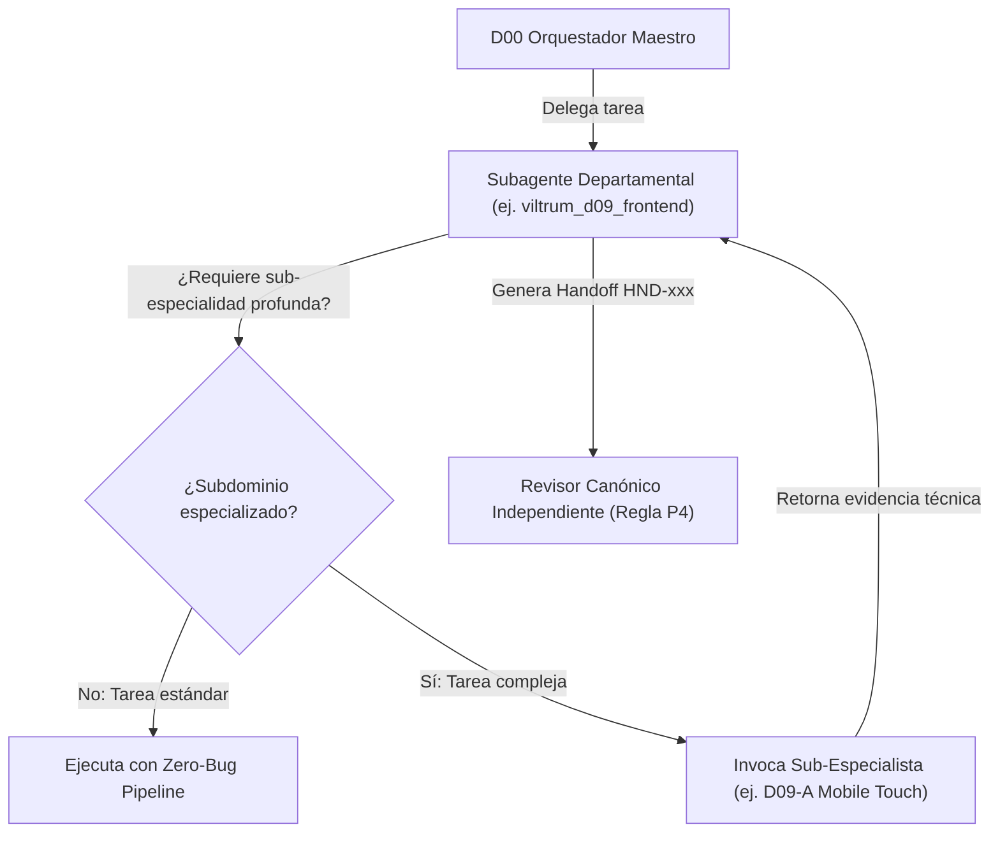

# Matriz Maestra de Especialización, Herramientas y Subagentes · Viltrum OS
**Fecha:** 2026-10-02  
**Versión:** 2.0.0  
**Autor:** D00 Control Plane (Lead Orchestrator)  
**Alcance:** 23 Departamentos (D00 a D22) — Ecosistema Multi-Agente Viltrum

---

## 1. Principios Rectores de Especialización y Subagentes

1. **Doctrina de No Autoaprobación (Regla P4):** Ningún departamento ni subagente aprueba su propio trabajo. Cada entregable requiere un revisor independiente según `departments.yaml`.
2. **Capacidad de Creación de Subagentes por Perfil:** Cada departamento opera como un nodo autónomo equipado con `enable_subagent_tools: true`. Cuando una tarea requiere profundidad técnica en un subdominio, el perfil no sobrecarga su contexto (<64 KiB, Regla P5); en su lugar, instancia un **subagente especializado** en esa área exacta.
3. **Principio "Todo Está Creado" (Open Source First):** Ningún departamento construye desde cero componentes, algoritmos o utilidades que cuenten con soluciones consolidadas y mantenidas en el ecosistema open source (evaluadas previamente por D21).
4. **Conexión Dinámica de Herramientas (MCP Toggling):** Cada subagente se equipa únicamente con los servidores MCP y herramientas CLI pertinentes a su función para maximizar el razonamiento y evitar la dispersión de tokens.

---

## 2. Matriz Departamental: Herramientas, Conexiones, Secuencia y Subagentes

---

### F0 — CONTROL PLANE

#### D00 · Orquestación, Cobertura y Riesgo (`orchestrator`)
- **Autonomía:** A2 | **Revisor Canónico:** Humano | **Modelo:** Sonnet / Lead Orchestrator
- **Herramientas Open Source:** `SQLite WAL` (mensajería persistente), `langgraph` (grafos de decisión), `psutil` (monitoreo de procesos y salud de workers).
- **Conexiones MCP:** `GitKraken` (visibilidad de ramas y PRs).
- **Skills:** `orquestar`, `agy-customizations`, `antigravity-guide`.
- **Secuencia de Trabajo (SOP):**
  1. *Clasificación:* Evaluar intención, tipo de cambio y riesgo (R1-R3).
  2. *Verificación de precedentes:* Comprobar `.viltrum/status.md` y `.viltrum/commercial.md` (C1 vigente).
  3. *Delegación:* Instanciar departamentos con paquetes de entrada <64 KiB.
  4. *Custodia de compuertas:* Bloquear avance si falta revisión independiente (G0-G8).
- **Diagnóstico Actual:**
  - *Qué tan bien lo hace ahora:* Excelente orquestación determinista, manejo de fallbacks de proveedores y canal SQLite WAL activo.
  - *Qué le falta:* Dashboard web interactivo en tiempo real integrado en HAPI que visualice el árbol de ejecución de subagentes.
- **Sub-especialistas que puede crear:**
  - `D00-Audit`: Mapeo de inventario y consistencia de artefactos en paralelo.
  - `D00-GateKeeper`: Verificación mecánica estricta de listas de comprobación previas a compuertas.

---

### F1 — NEGOCIO Y PRODUCTO

#### D01 · Descubrimiento y Requisitos (`discovery`)
- **Autonomía:** A1 | **Revisor Canónico:** D02 | **Modelo:** Opus
- **Herramientas Open Source:** `cucumber/gherkin` (sintaxis Given/When/Then), `markdown-table-generator`, utilidades de análisis de transcripciones.
- **Conexiones MCP:** `context7` (búsqueda de documentación de producto), `notebooklm-mcp` (análisis de grabaciones y actas de cliente).
- **Skills:** `design-md`, `software-engineering-principles`.
- **Secuencia de Trabajo (SOP):**
  1. *Ingesta:* Lectura de insumos del cliente, chats o actas.
  2. *Extracción de Criterios:* Formular historias de usuario con criterios de aceptación verificables.
  3. *Handoff:* Emisión de `HND-xxx` con matriz de requisitos hacia D02.
- **Diagnóstico Actual:**
  - *Qué tan bien lo hace ahora:* Buen análisis conceptual; tiende a alucinar si no se restringe contra el código fuente real (como ocurrió en `DOCS-gap.md`).
  - *Qué le falta:* Validación cruzada obligatoria contra el código del repositorio antes de emitir informes de brechas.
- **Sub-especialistas que puede crear:**
  - `D01-Interviewer`: Extracción de requisitos desde minutas de reuniones y audios.
  - `D01-GherkinWriter`: Redacción formal de especificaciones ejecutables.

#### D02 · Alcance, Negocio y Prioridad (`scope`)
- **Autonomía:** A1 | **Revisor Canónico:** D01 | **Modelo:** Sonnet
- **Herramientas Open Source:** `MoSCoW Prioritizer`, algoritmos de ponderación RICE/Kano.
- **Conexiones MCP:** `context7`, `notebooklm-mcp`.
- **Skills:** `software-engineering-principles`.
- **Secuencia de Trabajo (SOP):**
  1. *Contraste:* Evaluar requisitos de D01 contra `C1-propuesta.md` y `DECISIONES.md`.
  2. *Poda:* Excluir tajantemente funcionalidades fuera de presupuesto o acuerdos (ej. exclusión de CRM).
  3. *Dictamen:* Emitir veredicto formal de alcance.
- **Diagnóstico Actual:**
  - *Qué tan bien lo hace ahora:* Impecable rigor (demostrado en `DOCS-gap-review.md` al rechazar alucinaciones y proteger las decisiones vinculantes).
  - *Qué le falta:* Automatización del cálculo de trade-offs de capacidad vs. costo.
- **Sub-especialistas que puede crear:**
  - `D02-MoSCoW`: Ponderación estricta de tareas frente al presupuesto de horas/días.
  - `D02-ContractGuard`: Verificación de cláusulas comerciales y compromisos legales.

---

### F2 — DISEÑO Y EXPERIENCIA

#### D04 · UX Research y Arquitectura de Información (`ux-research`)
- **Autonomía:** A1 | **Revisor Canónico:** D05 | **Modelo:** Sonnet
- **Herramientas Open Source:** `Mermaid.js` (flowcharts y sequence diagrams), generadores de sitemaps, plantillas de heurísticas de Nielsen.
- **Conexiones MCP:** `StitchMCP` (análisis de pantallas), `notebooklm-mcp`.
- **Skills:** `ui-ux-department`, `canvas-design`.
- **Secuencia de Trabajo (SOP):**
  1. *Journey Mapping:* Diseñar mapa de recorrido de usuario de extremo a extremo.
  2. *Information Architecture:* Definir jerarquía de navegación y sitemap.
  3. *Evaluación Heurística:* Eliminar puntos de fricción cognitiva antes de maquetar.
- **Diagnóstico Actual:**
  - *Qué tan bien lo hace ahora:* Buen diseño de flujos en markdown.
  - *Qué le falta:* Generación automatizada de prototipos wireframe interactivos en HTML puro para validación temprana.
- **Sub-especialistas que puede crear:**
  - `D04-FlowArchitect`: Generación de diagramas de estado de usuario.
  - `D04-HeuristicAuditor`: Auditoría de las 10 heurísticas de usabilidad.

#### D05 · UI Premium y Sistema de Diseño (`ui-design-system`)
- **Autonomía:** A2 | **Revisor Canónico:** D07 | **Modelo:** Sonnet
- **Herramientas Open Source:** `@radix-ui/primitive`, `tailwind-merge`, `clsx`, `class-variance-authority (CVA)`, `lucide-react`.
- **Conexiones MCP:** `21st` (búsqueda e importación de componentes UI pulidos), `StitchMCP` (sistemas de diseño y generación visual).
- **Skills:** `21st-ui-build`, `21st-ui-explore`, `21st-ui-review`, `design-taste-frontend`, `ui-design-system`, `better-typography`, `emilkowal-animations`, `framer-motion`.
- **Secuencia de Trabajo (SOP):**
  1. *Exploración:* Buscar componentes existentes en 21st UI y librerías open-source antes de diseñar.
  2. *Tokenización:* Definir escala tipográfica, espaciados y tokens cromáticos semánticos.
  3. *Composición:* Integrar componentes accesibles con microinteracciones refinadas.
- **Diagnóstico Actual:**
  - *Qué tan bien lo hace ahora:* Muy alto nivel con las skills de 21st y Emil Kowalski.
  - *Qué le falta:* Automatizar la sincronización de tokens con Figma Tokens / Style Dictionary.
- **Sub-especialistas que puede crear:**
  - `D05-TokenManager`: Gestión y validación de variables CSS y tokens de diseño.
  - `D05-ComponentExplorer`: Búsqueda y adaptación de átomos y moléculas desde 21st UI.

#### D06 · Estados, Resiliencia y Microinteracciones (`ux-states`)
- **Autonomía:** A1 | **Revisor Canónico:** D14 | **Modelo:** Sonnet
- **Herramientas Open Source:** `react-error-boundary`, `sonner` (toasts accesibles), `vaul` (drawers), componentes Skeleton shimmer.
- **Conexiones MCP:** `21st`.
- **Skills:** `emilkowal-animations`, `framer-motion`, `animate-text`.
- **Secuencia de Trabajo (SOP):**
  1. *Matriz de Estados:* Exigir y verificar los 6 estados obligatorios:
     - 1. Loading (esqueletos animados, sin pantallas congeladas)
     - 2. Empty (estado vacío con CTA de salida)
     - 3. Error (mensaje comprensible + botón de reintento)
     - 4. Success (feedback visual discreto)
     - 5. Offline (banner informativo y cache local)
     - 6. Partial (degradación visual si falla un módulo no crítico)
- **Diagnóstico Actual:**
  - *Qué tan bien lo hace ahora:* Define bien las reglas conceptuales.
  - *Qué le falta:* Inyección automática de decoradores en Storybook o pruebas de snapshot por estado.
- **Sub-especialistas que puede crear:**
  - `D06-StateAuditor`: Escaneo de componentes para asegurar que no falte ningún estado de los seis obligatorios.

#### D07 · Accesibilidad Web (`accessibility`)
- **Autonomía:** A1 | **Revisor Canónico:** D14 | **Modelo:** Sonnet
- **Herramientas Open Source:** `axe-core`, `pa11y`, `eslint-plugin-jsx-a11y`, simuladores de daltonismo.
- **Conexiones MCP:** Ninguno específico (opera vía CLI / browser runner).
- **Skills:** `better-typography`, `software-engineering-principles`.
- **Secuencia de Trabajo (SOP):**
  1. *Auditoría Automática:* Ejecutar escaneo estático de tags, labels, roles y contraste con `axe-core`.
  2. *Auditoría Manual:* Verificar navegación 100% por teclado (foco visible, escape, trampas de foco).
  3. *Verificación de Lector de Pantalla:* Probar anuncios aria-live y etiquetas descriptivas.
- **Diagnóstico Actual:**
  - *Qué tan bien lo hace ahora:* Conoce a fondo WCAG 2.2 AA.
  - *Qué le falta:* Ejecución headless de `pa11y-ci` integrada en el pipeline de CI/CD para bloquear commits no accesibles.
- **Sub-especialistas que puede crear:**
  - `D07-KeyboardTester`: Verificación de secuencias de tabulación y restauración de foco.
  - `D07-ContrastChecker`: Auditoría matemática de ratios de contraste cromático.

#### D08 · Contenido, SEO, i18n y Conversión (`content-seo`)
- **Autonomía:** A1 | **Revisor Canónico:** D02 | **Modelo:** Sonnet
- **Herramientas Open Source:** `schema-dts` (tipado JSON-LD), `gray-matter`, `i18next-parser`, `readability-scores`.
- **Conexiones MCP:** `context7`.
- **Skills:** `better-typography`.
- **Secuencia de Trabajo (SOP):**
  1. *Copywriting y Microcopy:* Redacción orientada a conversión y fidelidad de marca.
  2. *Paridad i18n:* Ejecutar scripts de paridad (`i18n-parity-check.mjs`) para placeholders y términos protegidos.
  3. *SEO Técnico:* Inyectar metadatos OpenGraph, hreflang bidireccional y JSON-LD válido según Schema.org.
- **Diagnóstico Actual:**
  - *Qué tan bien lo hace ahora:* Extraordinario (acaba de auditar con precisión DE y HT detectando errores de pluralización y compuestos léxicos).
  - *Qué le falta:* Conexión directa con Google Search Console API para auditorías de indexación en vivo.
- **Sub-especialistas que puede crear:**
  - `D08-Linguist`: Auditoría y curaduría lingüística nativa por cada idioma objetivo.
  - `D08-SEOSchema`: Generación y validación de marcado Schema.org / JSON-LD.

---

### F3 — INGENIERÍA

#### D03 · Arquitectura de Solución (`architecture`)
- **Autonomía:** A1 | **Revisor Canónico:** Humano | **Modelo:** Opus
- **Herramientas Open Source:** `dependency-cruiser` (validación de límites modulares), `madge` (detección de dependencias circulares), `ts-morph` (análisis AST), `openapi-typescript`.
- **Conexiones MCP:** `context7`, `GitKraken`.
- **Skills:** `software-engineering-principles`.
- **Secuencia de Trabajo (SOP):**
  1. *Definición de Topología:* Diseñar monolito modular / hexagonal / BFF.
  2. *Contratos de Interfaces:* Redactar contratos OpenAPI 3.1 y esquemas Zod compartidos.
  3. *ADR:* Registrar Decisiones de Arquitectura irreversibles.
- **Diagnóstico Actual:**
  - *Qué tan bien lo hace ahora:* Sólido en diseño modular y aislamiento de fallos.
  - *Qué le falta:* Generación automatizada de diagramas C4 dinámicos a partir del AST del repositorio.
- **Sub-especialistas que puede crear:**
  - `D03-A`: Topología & Patrones (Monolito modular, Hexagonal, BFF).
  - `D03-B`: Contratos & Protocolos (OpenAPI 3.1, Zod, Idempotency-Keys).
  - `D03-C`: Concurrencia & Consistencia (Distributed locks, invalidación reactiva de caché).

#### D09 · Frontend y Calidad de Interfaz (`frontend`)
- **Autonomía:** A3 | **Revisor Canónico:** D14 | **Modelo:** Sonnet
- **Herramientas Open Source:** `Vite`, `React 19`, `Tailwind CSS v4`, `TanStack Query`, `motion/react`, `open-source-integration`.
- **Conexiones MCP:** `21st`, `StitchMCP`.
- **Skills:** `21st-ui-build`, `mobile-native-experience`, `zero-bug-pipeline`, `open-source-integration`, `responsive-design`, `software-engineering-principles`.
- **Secuencia de Trabajo (SOP):**
  1. *Fase Evaluar:* Analizar impacto de dependencias y estado actual.
  2. *Fase Integrar:* Implementar componentes reutilizables sin hardcodear textos ni opciones.
  3. *Fase Verificar (Zero-Bug):* Compilación Vite, pruebas puras, inspección móvil (safe-areas).
- **Diagnóstico Actual:**
  - *Qué tan bien lo hace ahora:* Muy alto nivel; build limpio y ejecución rápida en 6 segundos.
  - *Qué le falta:* Automatización de pruebas de regresión visual de layouts en múltiples resoluciones.
- **Sub-especialistas que puede crear:**
  - `D09-A`: Mobile Native Experience & Touch (Bottom Sheets, snap points, pull-to-refresh, safe-area).
  - `D09-B`: Responsive Layouts & Desktop Ergonomics (Container queries, fluid grid).
  - `D09-C`: Design Tokens & UI Atoms (Tipografía, elevaciones, microinteracciones).
  - `D09-D`: State & Data Synchronization (TanStack Query, SWR, mutaciones optimistas).

#### D10 · Backend, APIs y Reglas de Negocio (`backend`)
- **Autonomía:** A3 | **Revisor Canónico:** D12 | **Modelo:** Opus
- **Herramientas Open Source:** `Node.js 24`, `Zod`, `Fastify / Express`, `pino` (structured logger), `rate-limiter-flexible`, `helmet`.
- **Conexiones MCP:** `supabase-mcp-server`, `context7`.
- **Skills:** `software-engineering-principles`, `zero-bug-pipeline`.
- **Secuencia de Trabajo (SOP):**
  1. *Validación en Frontera:* Esquemas Zod en cada entrada HTTP.
  2. *Lógica de Negocio:* Funciones puras desacopladas del protocolo de transporte.
  3. *Acceso a Datos:* Consultas parametrizadas, control de transacciones ACID y pool seguro.
- **Diagnóstico Actual:**
  - *Qué tan bien lo hace ahora:* Robusto en endpoints Node/Express y middleware de seguridad.
  - *Qué le falta:* Suites de pruebas de integración de API con contenedores de base de datos efímeros (`testcontainers`).
- **Sub-especialistas que puede crear:**
  - `D10-A`: Core API Runtime & Defensive Middlewares (Streaming, rate-limits, control de latencia).
  - `D10-B`: Data Access & Query Engine (Pools, transacciones ACID, optimización de queries).

#### D11 · Base de Datos y Gobierno del Dato (`data`)
- **Autonomía:** A3 | **Revisor Canónico:** D12 | **Modelo:** Opus
- **Herramientas Open Source:** `PostgreSQL 15+`, `Supabase CLI`, `pg-formatter`, `pgTAP` (pruebas unitarias SQL), `dbdocs`.
- **Conexiones MCP:** `supabase-mcp-server` (gestión directa de migraciones, tablas y advisors).
- **Skills:** `software-engineering-principles`.
- **Secuencia de Trabajo (SOP):**
  1. *Modelado 3NF:* Estructurar tablas atómicas con claves foráneas e índices explícitos.
  2. *Migración Idempotente:* Crear scripts SQL numerados con reversión garantizada.
  3. *Seguridad:* Definir Row Level Security (RLS) restrictivo para cada rol.
- **Diagnóstico Actual:**
  - *Qué tan bien lo hace ahora:* Excelente gobierno de migraciones y esquemas Supabase.
  - *Qué le falta:* Pruebas automatizadas de rendimiento de planes de ejecución (`EXPLAIN ANALYZE`) antes de aplicar migraciones.
- **Sub-especialistas que puede crear:**
  - `D11-A`: Data Modeler & Normalization (Diseño relacional 3NF y restricciones).
  - `D11-B`: Query Performance & Indexing (Optimización de índices, particionamiento, RLS).

#### D18 · IA, Agentes y Guardrails (`ai-agents`)
- **Autonomía:** A2 | **Revisor Canónico:** D12 | **Modelo:** Opus
- **Herramientas Open Source:** `LangGraph`, `instructor` (structured outputs garantizados), `groq-sdk`, `tiktoken`, `guardrails-ai`.
- **Conexiones MCP:** `context7`, `notebooklm-mcp`.
- **Skills:** `software-engineering-principles`.
- **Secuencia de Trabajo (SOP):**
  1. *Diseño de Flujo:* Grafo determinista de agentes con estados tipados en LangGraph.
  2. *Guardrails:* Inyección de filtros contra inyección de prompts y reglas de veracidad (grounding).
  3. *Presupuesto de Tokens:* Conteo estricto y fallback humano/determinista si se agota la cuota.
- **Diagnóstico Actual:**
  - *Qué tan bien lo hace ahora:* Buen control de guardrails en el asistente editorial de QuisqueyaHome.
  - *Qué le falta:* Pipeline automatizado de evaluación de respuestas (RAG Triad: Context Relevance, Groundedness, Answer Relevance) con datasets sintéticos.
- **Sub-especialistas que puede crear:**
  - `D18-GuardrailEngineer`: Filtros de seguridad, sanitización y grounding estricto.
  - `D18-AgentArchitect`: Construcción de grafos cíclicos y supervisores con LangGraph.

#### D19 · Integraciones y Automatización (`integrations`)
- **Autonomía:** A3 | **Revisor Canónico:** D12 | **Modelo:** Sonnet
- **Herramientas Open Source:** `Svix` (verificación de firmas de webhooks), `axios-retry`, `bullmq` (colas con Redis/PostgreSQL), `crypto`.
- **Conexiones MCP:** `context7`.
- **Skills:** `software-engineering-principles`, `zero-bug-pipeline`.
- **Secuencia de Trabajo (SOP):**
  1. *Firma Criptográfica:* Verificar HMAC en cada webhook entrante antes de procesar el body.
  2. *Idempotencia:* Almacenar `idempotency_key` con TTL para ignorar eventos duplicados.
  3. *Cola Asíncrona:* Procesar en background con reintentos exponenciales y dead-letter queue.
- **Diagnóstico Actual:**
  - *Qué tan bien lo hace ahora:* Buen manejo de contratos de integración y webhooks HTTP.
  - *Qué le falta:* Simulación local de webhooks con mock servers verificables en CI.
- **Sub-especialistas que puede crear:**
  - `D19-WebhookGuard`: Validación estricta de firmas HMAC y anti-replay.
  - `D19-QueueMaster`: Gestión de colas resilientes y conciliación de eventos asíncronos.

---

### F4 — ASSURANCE

#### D12 · Seguridad, Privacidad y DevSecOps (`security`)
- **Autonomía:** A1 | **Revisor Canónico:** Humano | **Modelo:** Opus
- **Herramientas Open Source:** `Gitleaks` (detección de secretos), `Semgrep` (SAST), `Trivy` (escaneo de vulnerabilidades en contenedores y npm), `OWASP ZAP`.
- **Conexiones MCP:** `supabase-mcp-server` (auditoría de RLS y asesores de seguridad).
- **Skills:** `software-engineering-principles`.
- **Secuencia de Trabajo (SOP):**
  1. *Modelado de Amenazas:* STRIDE / DREAD sobre nuevas rutas o tablas.
  2. *Escaneo de Código y Secretos:* Bloquear commits con variables de entorno o API keys expuestas.
  3. *Cumplimiento Normativo:* Auditar apego a la Ley 172-13 (plazos de acceso/supresión) y GDPR.
- **Diagnóstico Actual:**
  - *Qué tan bien lo hace ahora:* Excelente (demostrado en `PRIVACIDAD-review-D12.md` con revisión exhaustiva de la Ley 172-13 y protección de la regla H3).
  - *Qué le falta:* Ejecución automatizada de Gitleaks y Semgrep pre-commit en todos los repositorios.
- **Sub-especialistas que puede crear:**
  - `D12-A`: Identity, Auth & RBAC/RLS Governance (Postgres RLS, JWT, cookies seguras).
  - `D12-B`: SAST, Secret Scanning & Infrastructure Hardening (Semgrep, Gitleaks, Trivy).

#### D13 · Git, GitHub y Gobierno del Código (`git-governance`)
- **Autonomía:** A3 | **Revisor Canónico:** D03 | **Modelo:** Haiku / Sonnet
- **Herramientas Open Source:** `commitlint`, `husky`, `simple-git`, `conventional-changelog`.
- **Conexiones MCP:** `GitKraken` (gestión avanzada de ramas, diffs, PRs y revisiones).
- **Skills:** `software-engineering-principles`.
- **Secuencia de Trabajo (SOP):**
  1. *Revisión de Historia:* Verificar que las ramas salgan del trunk autorizado.
  2. *Commits Convencionales:* Exigir semántica clara (`feat`, `fix`, `chore`, `docs`).
  3. *Protección de Ramas:* Asegurar que `main` requiera checks de CI y revisión aprobada.
- **Diagnóstico Actual:**
  - *Qué tan bien lo hace ahora:* Muy ordenado; genera commits convencionales limpios.
  - *Qué le falta:* Automatización de changelogs semánticos automáticos vinculados a etiquetas git (tags).
- **Sub-especialistas que puede crear:**
  - `D13-PRInspector`: Auditoría de diffs y verificación de ramas limpias antes del merge.

#### D14 · QA Funcional, E2E y Bug Hunting (`qa`)
- **Autonomía:** A2 | **Revisor Canónico:** D00 | **Modelo:** Sonnet
- **Herramientas Open Source:** `Playwright`, `node:test`, `vitest`, `msw` (Mock Service Worker).
- **Conexiones MCP:** Ninguno (ejecución directa en browser y runner).
- **Skills:** `zero-bug-pipeline`.
- **Secuencia de Trabajo (SOP):**
  1. *Smoke Tests:* Probar que la aplicación levante y las rutas críticas respondan código 200.
  2. *Flujos Críticos E2E:* Automatizar escenarios de búsqueda, filtros, guardado y envío de formularios.
  3. *Reporte Reproducible:* Documentar cada defecto con pasos exactos, consola del navegador y traza de red.
- **Diagnóstico Actual:**
  - *Qué tan bien lo hace ahora:* Muy eficaz en suites puras (`node --test`) y scripts de regresión.
  - *Qué le falta:* Despliegue de Playwright con grabación de video de traza en entornos de staging.
- **Sub-especialistas que puede crear:**
  - `D14-BugHunter`: Cacería exploratoria de comportamientos inesperados y casos borde.
  - `D14-E2EAutomator`: Escritura de scripts Playwright reproducibles.

#### D15 · Rendimiento, Carga y Confiabilidad (`performance`)
- **Autonomía:** A1 | **Revisor Canónico:** D03 | **Modelo:** Sonnet
- **Herramientas Open Source:** `autocannon` (HTTP benchmarking), `k6`, `Lighthouse CI`, `rollup-plugin-visualizer`, `clinic.js`.
- **Conexiones MCP:** Ninguno.
- **Skills:** `software-engineering-principles`.
- **Secuencia de Trabajo (SOP):**
  1. *Auditoría de Frontend:* Medir LCP (<2.5s), INP (<200ms) y CLS (<0.1) bajo throttling 4G.
  2. *Auditoría de Bundle:* Identificar módulos pesados y aplicar code splitting / lazy loading.
  3. *Pruebas de Estrés Backend:* Probar saturación de endpoints y percentiles de respuesta p95/p99.
- **Diagnóstico Actual:**
  - *Qué tan bien lo hace ahora:* Buen análisis de presupuestos y cuellos de botella (entregable `D15-load-review.md`).
  - *Qué le falta:* Automatizar tests de carga periódicos con k6 contra endpoints staging.
- **Sub-especialistas que puede crear:**
  - `D15-A`: Core Web Vitals & Client Profiling (LCP, INP, análisis de bundle).
  - `D15-B`: Backend Saturation & Load Testing (k6, autocannon, p95/p99).

---

### F5 — OPERACIÓN

#### D16 · DevOps, Despliegue y Release (`devops`)
- **Autonomía:** A3 | **Revisor Canónico:** D12 | **Modelo:** Sonnet
- **Herramientas Open Source:** `Docker`, `docker-compose`, `Caddy` (reverse proxy HTTPS automático), `actionlint` (linter de GitHub Actions), `ssh`.
- **Conexiones MCP:** `GitKraken`.
- **Skills:** `software-engineering-principles`.
- **Secuencia de Trabajo (SOP):**
  1. *Empaquetado Limpio:* Dockerfile multi-stage omitiendo dependencias dev (`npm ci --omit=dev`).
  2. *Respaldo Obligatorio:* Validar snapshot de base de datos antes de cualquier release.
  3. *Despliegue y Verificación:* Reemplazo de contenedor con zero-downtime y healthcheck posterior.
- **Diagnóstico Actual:**
  - *Qué tan bien lo hace ahora:* Sólido en pipelines de GitHub Actions y scripts de despliegue.
  - *Qué le falta:* Implementación de staging aislado por túnel SSH/VPN para pruebas previas a producción.
- **Sub-especialistas que puede crear:**
  - `D16-DockerOptimizer`: Reducción de tamaño de imágenes y multi-stage caching.
  - `D16-ReleaseManager`: Verificación de respaldos y orquestación de despliegues.

#### D17 · Observabilidad, SRE e Incidentes (`observability`)
- **Autonomía:** A2 | **Revisor Canónico:** D16 | **Modelo:** Sonnet
- **Herramientas Open Source:** `pino-pretty`, `OpenTelemetry (otel-js)`, `Prometheus client`, `uptime-kuma`.
- **Conexiones MCP:** Ninguno.
- **Skills:** `software-engineering-principles`.
- **Secuencia de Trabajo (SOP):**
  1. *Estructuración de Logs:* Obligatoriedad de NDJSON con `timestamp`, `level`, `trace_id` y `err`.
  2. *Monitoreo de Salud:* Endpoints `/health` y `/ready` con comprobación viva de base de datos.
  3. *Triage de Incidentes:* Clasificación de severidad y runbook de mitigación.
- **Diagnóstico Actual:**
  - *Qué tan bien lo hace ahora:* Registra logs adecuados en servidor Node.
  - *Qué le falta:* Centralización de logs y alertas automáticas a canales Discord/Slack cuando el ratio de errores supere 1%.
- **Sub-especialistas que puede crear:**
  - `D17-LogAnalyzer`: Búsqueda y correlación de trazas de errores en logs.
  - `D17-HealthChecker`: Verificación de latencias de dependencias y tiempos de respuesta.

#### D20 · Documentación, Formación y Mantenimiento (`documentation`)
- **Autonomía:** A2 | **Revisor Canónico:** D00 | **Modelo:** Sonnet
- **Herramientas Open Source:** `TypeDoc`, `swagger-ui-dist`, `markdown-toc`, `starlight / docusaurus`.
- **Conexiones MCP:** `context7`, `notebooklm-mcp`.
- **Skills:** `software-engineering-principles`.
- **Secuencia de Trabajo (SOP):**
  1. *Inventario de Documentación:* Localizar vacíos en READMEs, especificaciones y guías operativas.
  2. *Generación de Referencias:* Sincronizar esquemas de API y contratos con la documentación.
  3. *Runbooks:* Escribir guías paso a paso para resolución de desastres y mantenimiento habitual.
- **Diagnóstico Actual:**
  - *Qué tan bien lo hace ahora:* Muy ordenado en redacción técnica.
  - *Qué le falta:* Validación en CI de enlaces rotos dentro de la documentación (`markdown-link-check`).
- **Sub-especialistas que puede crear:**
  - `D20-APIDocGenerator`: Extracción de documentación viva desde contratos Zod/OpenAPI.
  - `D20-RunbookWriter`: Redacción de procedimientos operativos estándar para administradores.

---

### F6 — CONOCIMIENTO

#### D21 · Investigación y Decisión Construir/Comprar/Integrar (`research`)
- **Autonomía:** A1 | **Revisor Canónico:** D03 | **Modelo:** Sonnet
- **Herramientas Open Source:** APIs de `npms.io`, `bundlephobia` (tamaño de librerías), análisis de licencias con `license-checker`, métricas de mantenimiento en GitHub.
- **Conexiones MCP:** `context7` (consulta de documentación de librerías candidatas), `notebooklm-mcp`.
- **Skills:** `open-source-integration`, `software-engineering-principles`.
- **Secuencia de Trabajo (SOP):**
  1. *Búsqueda de Precedentes:* Buscar librerías maduras en NPM/GitHub antes de que nadie escriba una línea de código.
  2. *Matriz de Decisión:* Evaluar 4 criterios obligatorios:
     - 1. Seguridad y vulnerabilidades conocidas
     - 2. Actividad de mantenimiento y comunidad
     - 3. Licencia compatible (MIT, Apache 2.0 vs GPL)
     - 4. Plan de salida (facilidad para desacoplar si falla la librería)
  3. *Dictamen:* Recomendar si Construir, Comprar o Integrar.
- **Diagnóstico Actual:**
  - *Qué tan bien lo hace ahora:* Buen criterio analítico.
  - *Qué le falta:* Automatización de reportes de compatibilidad de dependencias entre paquetes NPM.
- **Sub-especialistas que puede crear:**
  - `D21-LibraryAuditor`: Análisis de licencias, CVEs y actividad de repositorios open source.
  - `D21-SpikeTester`: Creación de pruebas de concepto rápidas en sandbox para validar librerías.

#### D22 · Gestión del Conocimiento y Contexto (`knowledge-ops`)
- **Autonomía:** A2 | **Revisor Canónico:** D00 | **Modelo:** Sonnet
- **Herramientas Open Source:** `tiktoken` (conteo exacto de tokens BPE), `ripgrep` (búsqueda ultrarrápida), `markdown-chunker`.
- **Conexiones MCP:** `context7`, `notebooklm-mcp`.
- **Skills:** `software-engineering-principles`.
- **Secuencia de Trabajo (SOP):**
  1. *Empaquetado de Contexto:* Asegurar que cada prompt o tarea enviada a un subagente no exceda los 64 KiB de tokens (Regla P5).
  2. *Destilación Semántica:* Purgar archivos de log, datos binarios y ruido antes de alimentar a los perfiles.
  3. *Gobierno de Memoria:* Mantener actualizado `MEMORY.md` y los registros de lecciones aprendidas.
- **Diagnóstico Actual:**
  - *Qué tan bien lo hace ahora:* Mantiene disciplina en tamaños de handoffs.
  - *Qué le falta:* Indexación vectorial local automática (embeddings SQLite-vec) para recuperación de contexto sin saturar la ventana de contexto.
- **Sub-especialistas que puede crear:**
  - `D22-ContextPacker`: Compresión y estructuración de paquetes de trabajo para agentes.
  - `D22-MemoryCurator`: Mantenimiento de memorias persistentes y purga de información obsoleta.

---

## 3. Protocolo de Invocación y Sub-especialización Dinámica

Cada uno de los 23 subagentes registrados (`viltrum_d00` a `viltrum_d22`) cuenta con la capacidad de instanciar subagentes bajo el siguiente flujo estándar:



### Guía para que un Departamento Invoque un Subagente Especializado:
```python
# Ejemplo de invocación desde D09 Frontend a su sub-especialista D09-A:
invoke_subagent(
    Subagents=[{
        "TypeName": "self",  # hereda herramientas y contexto
        "Role": "D09-A Mobile Touch Specialist",
        "Prompt": "Implementa Bottom Sheet con snap points de 25%, 50% y 90% usando Vaul/Radix, con soporte de visualViewport para teclado virtual y gestos táctiles fluidos. Cumple Zero-Bug Pipeline y reporta evidencia.",
        "Model": "inherit"
    }]
)
```
