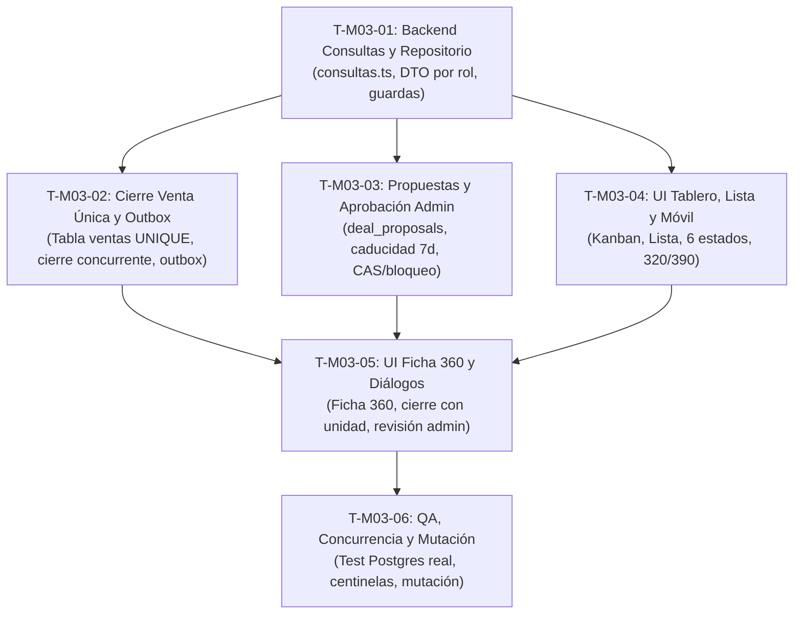

# D02 · Revisión independiente de la ficha M03 «Negocios» · 2026-10-13

**Ficha revisada:** `.viltrum/vre-os/spec/modulos/M03-negocios.md` (estado `REVIEW`)  
**Productor:** Codex (D01) · **Revisor independiente:** Antigravity (D02 Alcance, con mirada D14 de verificabilidad)  
**Marco normativo:** Decisión #44 (separación de proveedor), Decisión #47 (cierre de negocio, monto vs precio, propuestas asistente), `.specify/memory/constitution.md` y `.viltrum/vre-os/FLUJO-PASADAS.md`.

---

## Resumen

La ficha M03 «Negocios» (R1) incorpora con rigor ejemplar los mandatos de la Decisión #47 y la arquitectura modular limpia. Sus 31 criterios de aceptación (§8) son estrictamente verificables, vinculados a pruebas unitarias, de concurrencia en PostgreSQL y capturas multi-dispositivo. No existen hallazgos bloqueantes P0 ni P1: el modelo de datos propuesto y la separación de roles protegen la regla de venta única y la confidencialidad financiera. Se detectan desfases P2/P3 en §2 derivados de evidencia AS-IS heredada previa a los commits `6c610e3` y `e045c83`, donde la ruta `/negocios` y el vocabulario visual ya fueron parcialmente saneados. Con la corrección de dichas referencias y el corte propuesto en 6 tareas de ≤45 min, la especificación queda expedita para construcción.

---

## Tabla de hallazgos

| ID | Severidad | Evidencia (archivo:línea) | Corrección pedida | Dueño |
|---|---|---|---|---|
| **HAL-M03-01** | **P2** | `.viltrum/vre-os/spec/modulos/M03-negocios.md:68,78` | Actualizar las referencias de §2 sustituyendo `src/app/(crm)/pipeline/` por `src/app/(crm)/negocios/`. Reconocer que en HEAD (commit `6c610e3`, E1.0) los textos visibles (título, metadata, loading, error) ya usan «Negocios» (satisfaciendo REQ-03-01 en la vista). Retirar la cita del hito `10·40·50` (`vista.tsx:429`), eliminado en `e045c83`. | Codex (D01) |
| **HAL-M03-02** | **P3** | `.viltrum/vre-os/spec/modulos/M03-negocios.md:261-272` vs `:407-408` | Incorporar explícitamente `consultarPropuestasNegocio(actor, dealId, estado)` y `consultarEstadoSincronizacionNegocio(actor, id)` en la tabla de consultas objetivo de §5 para que coincida exactamente con los contratos declarados en el tramo construible de §9. | Codex (D01) |
| **HAL-M03-03** | **P3** | `.viltrum/vre-os/spec/modulos/M03-negocios.md:90` | Aclarar en §3 que `/negocios` es la URL canónica activa en la interfaz y que `/pipeline` opera bajo redirección permanente 308 (según `next.config.ts:14-15`), evitando la ambigüedad sobre la ruta pública principal. | Codex (D01) |

*Nota sobre severidades:* Ningún hallazgo clasifica como P0 (bloqueo crítico de negocio/seguridad) ni P1 (ambigüedad en criterios de aceptación o violación de invariantes). Los tres hallazgos son correcciones documentales de trazabilidad y sincronización con el HEAD del repositorio.

---

## Evaluación detallada de los 7 puntos

### 1. Fidelidad a la Decisión #47

La fidelidad de la ficha M03 frente a los cuatro preceptos de la Decisión #47 (`docs/contexto/decisiones.md:311`) es total y exhaustiva:

1. **Aprobación del asistente en un solo nivel, sin autoaprobación y caducidad de 7 días:**
   - *Especificación:* M03 §1 (líneas 33, 35, 56), §4 (líneas 199, 220, 230), §5 (líneas 281), §8 (CA-10, línea 372) y §9 (línea 407).
   - *Regla:* Cualquier administrador activo puede aprobar o rechazar con motivo obligatorio. Queda explícitamente prohibido que el autor de la propuesta se autoapruebe.
   - *Caducidad:* Se fija en 7 días exactos (`submittedAt + 604800s UTC`), evaluado estrictamente en servidor (`reloj < expiresAt`). Si el plazo vence, la propuesta no es ejecutable incluso si no ha corrido un scheduler en segundo plano.
2. **Monto comercial visible/editable por el broker vs precio real y comisión ajena solo admin:**
   - *Especificación:* M03 §1 (líneas 34, 48, 57), §4 (líneas 224-226, 232), §5 (línea 282) y §8 (CA-11, línea 373).
   - *Regla:* El broker visualiza y edita `amountCents` de sus propios negocios. El precio de lista real (`units.price`) y la comisión de terceros/repartos permanecen restringidos al administrador.
   - *Protección en profundidad:* Se prohíbe `SELECT *` con filtrado en JSX; la exclusión se impone en la consulta SQL por proyección DTO, bloqueando filtraciones en RSC, JSON, respuestas de error y CSV.
3. **Unidad concreta obligatoria al cerrar y no vendible dos veces:**
   - *Especificación:* M03 §1 (líneas 27, 34, 58), §4 (líneas 192, 213, 229), §5 (líneas 283-291) y §8 (CA-08/CA-12, líneas 370, 374).
   - *Regla:* El inventario fino no se exige para explorar negociaciones; pero al cerrar (`kind = won`), el broker está obligado a seleccionar o crear una unidad concreta del proyecto autorizado.
   - *Garantía física en BD:* Se exige una tabla/registro durable de ventas con `unitId NOT NULL + UNIQUE(unitId)` y `dealId NOT NULL + UNIQUE(dealId)`, inmune a borrados lógicos o cascadas. Se define una prueba concurrente mandatoria con dos conexiones simultáneas (CA-08) donde exactamente una confirma y la otra recibe HTTP 409 saneado.

---

### 2. Criterios de aceptación (§8, CA-01…CA-31)

- **Verificabilidad:** Todos los criterios del tramo construible (CA-01 a CA-23, más CA-28 a CA-30) poseen estructura formal *Dado... Cuando... Entonces...* y prescriben el oráculo exacto de verificación: comandos de test unitario (`node --test`), pruebas de integración con PostgreSQL real, aserciones transaccionales o inspección visual del DOM y capturas.
- **Rigor sin ambigüedad:** Ningún criterio del tramo activo es vago. Las áreas que aún carecen de definición comercial o técnica definitiva (como vistas compartidas CA-24, lotes CA-25, cohortes avanzadas CA-26, documentos KYC CA-27 y SLAs comerciales CA-31) fueron declaradas honestamente como **«EN ESPERA, no bloquea tramo actual»** conforme a los límites de la Decisión #47 y la doctrina D02.
- **Cobertura REQ vs CA:** Cada uno de los 15 requisitos de la ficha (§1, líneas 44-58) cuenta con al menos un criterio de aceptación asignado:
  - `REQ-03-01` (Vocabulario) → `CA-01`
  - `REQ-03-02` (Múltiples negocios e intereses) → `CA-03`, `CA-08`
  - `REQ-03-03` (Baja lógica y motivo/comentario) → `CA-07`, `CA-09`
  - `REQ-03-04` (Aprobación asistente) → `CA-10`
  - `REQ-03-05` (Precio real y comisión restringidos) → `CA-11`
  - `REQ-03-06` (Inventario por rangos / unidad al cierre) → `CA-12`, `CA-27`
  - `REQ-03-07` (Cliente fuera del CRM) → `CA-13`
  - `REQ-03-08` (Etapas y seguimiento) → `CA-02`, `CA-06`, `CA-14`
  - `REQ-03-09` (Rediseño y seis estados) → `CA-15`, `CA-16`, `CA-17`, `CA-18`, `CA-19`
  - `REQ-03-10` (SQL fuera de página) → `CA-04`, `CA-05`
  - `REQ-03-11` (Outbox y continuidad ante caídas) → `CA-20`, `CA-21`, `CA-22`, `CA-23`
  - `REQ-03-12` (Capacidades adicionales) → `CA-24`, `CA-25`, `CA-26`, `CA-27` (En espera)
  - `REQ-03-13` (Aprobación 1 nivel y 7 días) → `CA-10`
  - `REQ-03-14` (Monto comercial vs precio real) → `CA-06`, `CA-11`
  - `REQ-03-15` (Unidad concreta y venta única) → `CA-08`, `CA-12`

---

### 3. Coherencia interna

Se examinó la consistencia cruzada entre pantallas (§3), casos de uso (§4), datos (§5) y tramo construible (§9):
- **Catálogo de etapas:** Se mantiene uniforme en las 7 etapas oficiales: *Nuevo, Contactado, Presentación, Preselección, Negociación, Cierre, Perdido* (§3:101, §4:206-215). Los tres resultados de agrupamiento (*Abierto, Ganado, Perdido*) derivan limpiamente de `stage.kind`.
- **Roles y alcance:** Los privilegios de Administrador (`deals:*:all`), Broker (`deals:*:own`) y Asistente (proponente sin efectos directos, lectura no financiera) coinciden punto por punto entre las matrices de permisos de §1, §4 y §5.
- **Flujo de cierre y unidad:** En §3 (línea 128), §4 (línea 192), §5 (línea 287) y §9 (línea 405), el acto de cierre exige seleccionar o crear la unidad concreta en la misma transacción, impidiendo la venta duplicada.
- **Pérdida y archivo:** §3 (línea 128), §4 (línea 193) y §9 (línea 404) exigen concurrentemente motivo activo y comentario no blanco, asegurando que el contacto permanezca activo sin eliminación física.
- **Alineación de tramos:** §9 delimita estrictamente como construible lo cubierto por los contratos de §3-§5, separando con nitidez las capacidades en espera (vistas compartidas, edición avanzada de etapas, Twenty remoto).

---

### 4. Verificación de citas de código (§2)

Se seleccionaron y contrastaron **10 referencias** archivo:línea citadas en la ficha contra el código fuente real del proyecto:

| # | Cita en M03 (§2) | Afirmación de la ficha | Estado en el código real | Evaluación |
|---|---|---|---|---|
| 1 | `src/app/(crm)/pipeline/page.tsx:49, 57, 84` | Actor, `deals:view`, `visibleRows` y lectura de catálogos en página. | Código real en `src/app/(crm)/negocios/page.tsx:49, 57, 84`. Contiene exactamente esa lógica, pero la ruta fue renombrada a `negocios/` en commit `6c610e3`. | **Parcial** (Lógica exacta, ruta movida) |
| 2 | `page.tsx:38`, `loading.tsx:11`, `error.tsx:24`, `vista.tsx:182` | «Nomenclatura: Título, metadata, carga y error aún dicen el nombre antiguo […] REQ-03-01 todavía no satisfecho». | En `negocios/page.tsx:38`, `loading.tsx:11`, `error.tsx:24` y `vista.tsx:182` los textos ya dicen «Negocios» (actualizados en commit `6c610e3`). | **Fallo** (Cita desactualizada; ya corregido en HEAD) |
| 3 | `vista.tsx:144` | Suma activa formateada como USD sin separar monedas en cliente. | En `src/app/(crm)/negocios/vista.tsx:144-146`, `valorActivo` suma `amountCents` directamente con reduce y asume USD. | **Acierta** |
| 4 | `vista.tsx:393` | Etiqueta Confotur incondicional en la tarjeta. | En `src/app/(crm)/negocios/vista.tsx:420-422`, el badge «Confotur» se renderiza incondicionalmente para toda tarjeta. | **Acierta** (Desplazamiento menor: L420 vs L393) |
| 5 | `vista.tsx:429` | Hito Dominicano 10·40·50 fijo en tarjeta. | El bloque `10 · 40 · 50` existía en esa línea en versiones previas, pero fue eliminado en commit `e045c83`. | **Fallo** (Cita desactualizada por commit `e045c83`) |
| 6 | `src/application/pipeline/casos-de-uso.ts:43` | `cambiarEtapaDeNegocio` con unidad de trabajo, `reaches`, validación de destino, historial y auditoría. | `casos-de-uso.ts:43` define exactamente la función `cambiarEtapaDeNegocio` con todos los pasos descritos. | **Acierta** |
| 7 | `src/application/pipeline/cierre.ts:64, 92` | Cierre bloquea con `bloquearNegocio` y ejecuta ocho pasos transaccionales. | `cierre.ts:64` ejecuta `bloquearNegocio(dealId)` y línea 92 inicia el Paso 1 de sellado; contempla exactamente 8 pasos. | **Acierta** |
| 8 | `casos-de-uso.ts:338` y `repos/pipeline.ts:373` | `quitarPropiedad` llama a `DELETE` real de `deal_properties`. | `casos-de-uso.ts:338` (`quitarPropiedad`) llama a `eliminarPropiedad`, que en `repos/pipeline.ts:374` ejecuta `tx.delete(dealProperties)`. | **Acierta** |
| 9 | `src/app/api/pipeline/[id]/route.ts:56` y `etapa/route.ts:45` | Contrato de salida: PATCH devuelve el objeto negocio completo. | `route.ts:56` retorna `{ ok: true, negocio }` y `etapa/route.ts:45` retorna `{ ok: true, deal }`. | **Acierta** |
| 10 | `src/application/pipeline/casos-de-uso.test.ts:209, 407` | Pruebas que validan pérdida con comentario ausente (L209) y borrado físico DELETE (L407). | L209 prueba que pérdida sin comentario guarda `null`; L407 prueba que quitar borra la propiedad física. | **Acierta** |

*Citas adicionales verificadas:*
- `src/application/pipeline/cierre.test.ts:133, 347, 396, 452, 459, 470` → **Aciertan todas** (los 6 tests existen en las líneas exactas).
- `src/infrastructure/arquitectura.test.ts:120` → **Acierta** (guarda de lecturas condicionada a la existencia de `consultas.ts`).

**Balance de citas:** De las 10 referencias analizadas, **7 aciertan de forma exacta**, **1 acierta en concepto con desvío menor de líneas (+27 líneas)**, y **2 fallan por desactualización documental** frente a commits recientes (`6c610e3` y `e045c83`). La ficha reconoció explícitamente en §2:64 que la evidencia AS-IS era heredada de T-E1-1a sin re-verificación de runtime en R1.

---

### 5. Vocabulario y nomenclatura

- **Texto visible al usuario:** Ningún literal visible al usuario, título, etiqueta, metadata ni mensaje de error contiene el término «Pipeline» ni la antigua fase «Clasificación».
- **Cumplimiento de D-04 / Decisión #45:** En toda la especificación se emplea «Negocios» para el módulo y «Presentación» para la tercera etapa. En el código real de HEAD, la guarda `src/infrastructure/vocabulario.test.ts` (introducida en `6c610e3`) pasa al 100% (515/515 tests verdes).
- **Identificadores técnicos:** La ficha conserva explícitamente «pipeline» solo en rutas de API internas (`/api/pipeline`), nombres de tabla (`pipeline_stages`) y carpetas del backend (`src/application/pipeline/`), lo cual está expresamente autorizado por la Decisión #45.

---

### 6. Seis estados de UX y adaptabilidad móvil (320/390 px)

- **Seis estados obligatorios:** La ficha formaliza la matriz completa de seis estados en §3 (líneas 126-139) y en el criterio `CA-15` (línea 377):
  1. *Carga:* esqueletos `aria-busy` sin saltos de layout ni doble envío.
  2. *Vacío:* diferenciación de cartera vacía frente a filtros sin coincidencia.
  3. *Error:* mensajes contextuales junto al campo sin cerrar diálogos ni perder datos ingresados.
  4. *Sin conexión:* memoria solo lectura en cliente, prohibición de enviar mutaciones offline y aviso claro.
  5. *Éxito:* toast accesible, contadores sincronizados y distinción visual entre propuesta pendiente y cambio aprobado.
  6. *Permiso insuficiente:* HTTP 403 / 404 estricto sin filtración de datos en DTO.
- **Móvil 320 / 390 px:** Prescrito de forma mandatoria en §3 (líneas 96, 105, 115, 124, 158-170) y auditado en `CA-16` y `CA-17`:
  - Supresión de tablas con desplazamiento horizontal; adopción de tarjetas apilables y etapas colapsables.
  - Hojas inferiores (`Drawer`) para filtros y ficha 360 con cabecera y pie sticky sobre el área segura y dock del shell.
  - Dimensiones táctiles mínimas de 48×48 px y tipografía legible ≥13 px.

---

### 7. Tramo construible (§9) y propuesta de partición

El tramo de §9 es una lista cerrada y coherente que excluye deliberadamente las capacidades complejas que dependen de decisiones futuras (edición de etapas, analítica de cohortes, Twenty HTTP, etc.).

Se propone el corte en **6 tareas acotadas de ≤ 45 minutos** de agente, con orden y dependencias estrictas:

#### Detalle de tareas propuestas:

1. **T-M03-01 · Backend: Consultas desacopladas y DTO restrictivo por rol (≤ 40 min)**
   - *Objetivo:* Crear `src/application/pipeline/consultas.ts` y sus métodos en `repos/pipeline.ts` (`consultarTableroNegocios`, `consultarListaNegocios`, `consultarCatalogosNegocios`, `resumirNegocios`). Migrar el SQL de `negocios/page.tsx` satisfaciendo la guarda de `arquitectura.test.ts:120`. Proyección estricta: broker solo ve `amountCents` propio; admin ve precio real.
   - *Criterios de aceptación:* CA-01, CA-04, CA-05, CA-11.
   - *Dependencias:* Ninguna (base existente).

2. **T-M03-02 · Backend & Datos: Registro de Venta Única, Pérdida y Outbox (≤ 45 min)**
   - *Objetivo:* Migración DDL para tabla durable de ventas con `UNIQUE(unit_id)` y `UNIQUE(deal_id)`. Ajustar `cierre.ts` para exigir `unitId` y registrar venta atómica. Endurecer pérdida en `casos-de-uso.ts` exigiendo motivo activo + comentario obligatorio. Emitir `NegocioCambioEtapa` transaccional en outbox.
   - *Criterios de aceptación:* CA-06, CA-07, CA-08, CA-12, CA-20, CA-28.
   - *Dependencias:* T-M03-01.

3. **T-M03-03 · Backend & Datos: Propuestas del Asistente y Aprobación Admin (≤ 45 min)**
   - *Objetivo:* Migración DDL para tabla `deal_proposals` con control de caducidad a 7 días (`expiresAt`). Casos de uso para que el asistente registre propuestas no financieras sin mutación de dominio, y cualquier admin (distinto del autor) apruebe o rechace con motivo obligatorio mediante CAS/bloqueo transaccional. Implementar `consultarPropuestasNegocio`.
   - *Criterios de aceptación:* CA-10, CA-11, CA-28.
   - *Dependencias:* T-M03-01.

4. **T-M03-04 · Frontend: Tablero Kanban, Lista y Adaptabilidad Móvil (≤ 45 min)**
   - *Objetivo:* Conectar `src/app/(crm)/negocios/` a `consultas.ts`. Implementar paginación de lista, filtros en servidor, los 6 estados de UX (esqueletos, vacío contextual, error con reintento, modo offline lectura), adaptabilidad a 320/390 px (etapas colapsables) y navegación por teclado accesible sin drag obligatorio.
   - *Criterios de aceptación:* CA-01, CA-02, CA-03, CA-15, CA-16, CA-17, CA-18, CA-19.
   - *Dependencias:* T-M03-01.

5. **T-M03-05 · Frontend: Ficha 360, Diálogos de Cierre / Pérdida y Bandeja de Aprobación (≤ 45 min)**
   - *Objetivo:* Ficha en Drawer lateral con tabs Resumen, Seguimiento y Propiedades (con baja lógica). Diálogo de Cierre con selector/creación de unidad y monto comercial. Diálogo de No Concretado con motivo y comentario obligatorios. Panel de revisión de propuestas para Admin (aprobar/rechazar con motivo) y badge de caducidad para Asistente.
   - *Criterios de aceptación:* CA-06, CA-07, CA-08, CA-09, CA-10, CA-11, CA-12, CA-14, CA-15, CA-21, CA-23.
   - *Dependencias:* T-M03-02, T-M03-03, T-M03-04.

6. **T-M03-06 · QA & Verificación: Concurrencia en PostgreSQL, Seguridad y Mutación (≤ 40 min)**
   - *Objetivo:* Suite de pruebas de integración en BD real: carrera concurrente de doble cierre en dos conexiones simultáneas (CA-08), prueba de centinelas de proyección (CA-11), no autoaprobación y caducidad de propuesta (CA-10), pruebas de mutación independiente (CA-29). Verificación de suite completa (`tsc`, `lint`, `npm test`, `test:db`).
   - *Criterios de aceptación:* CA-28, CA-29, CA-30.
   - *Dependencias:* T-M03-05.

---

## Handoff

- **Para:** Orquestador (Claude / D00) y Autor de la ficha (Codex / D01).
- **Estado de entrega:** Revisión completada bajo perfil D02 con oráculos D14.
- **Acciones requeridas:**
  1. Codex (D01) debe aplicar las correcciones menores documentales indicadas en la tabla de hallazgos (`HAL-M03-01`, `HAL-M03-02`, `HAL-M03-03`), actualizando las referencias de §2 al directorio `negocios/` y alineando §5 con §9.
  2. Tras dicho ajuste menor, la ficha M03 puede ser promovida a estado `READY` en `spec/00-indice.md`.
  3. D00 puede proceder a despachar las tareas de construcción siguiendo el plan de corte de 6 tareas especificado en el Punto 7.
- **Regla de secretos:** Verificada. Ningún secreto, credencial ni variable de entorno fue expuesta en este informe ni en las corridas ejecutadas.

---

VEREDICTO: APROBADO CON CAMBIOS
