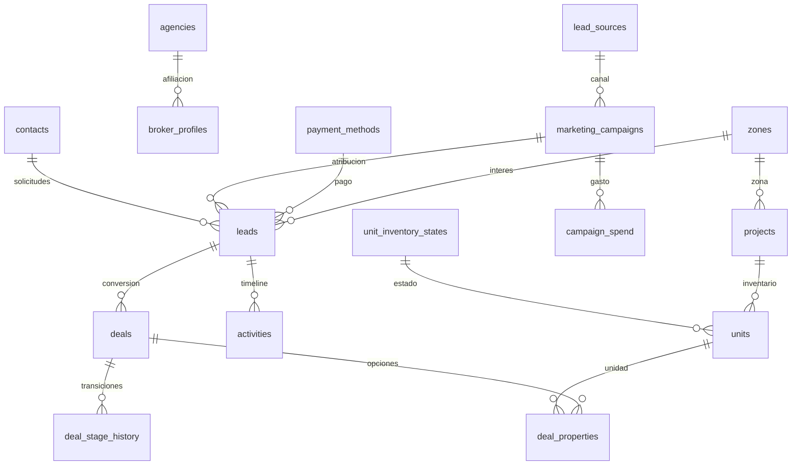

# D11 · Esquema ampliado y seed determinista

Fecha: 2026-10-04. Tarea: T-W1-D11. Productor: Codex / D11.
Revisor requerido: D12 de otro proveedor, con validación de comandos por Claude.
**Estado: implementación preparada, verificación incompleta; entrega detenida por regla de secretos. No aprobada.**

## Incidente que detiene la ejecución

El wrapper de verificación detectó una coincidencia con la credencial de conexión
en la salida interna capturada del proceso `npm run db:migrate`. Bloqueó la
publicación de esa salida y devolvió `SECRET_IN_TOOL_OUTPUT`. No se ha escrito ni
repetido la credencial en este entregable. La detección es por coincidencia textual;
no se verificó independientemente si el contexto constituía una filtración o una
coincidencia incidental. Se aplica conservadoramente la instrucción humana de parar.

El primer intento del wrapper también terminó sin imprimir el resultado; su
causa exacta no quedó acreditada. Después se cambió la invocación de npm a su CLI
por Node, sin shell. El segundo intento acreditó la detección anterior. **No se
continuó ejecutando comandos después de esa detección.**

El comando de migración pudo haber alcanzado la base antes del bloqueo de su salida.
Su estado final **no está verificado**. No se volvió a ejecutar ni se intentó
consultar para cerrar ese estado después del incidente. El seed no se ejecutó
contra PostgreSQL. Los conteos finales, la segunda corrida y las invariantes sobre
filas persistidas quedan pendientes.

## Mandato, clasificación y alcance

- Se leyó completo `.viltrum/dispatch/20261004T164016Z-D11-codex/PERFIL.md` y luego `TAREA.md`.
- El mandato padre no existe en este worktree. Se leyó la copia de
  `C:/Users/wilbe/Documents/QuisqueyaHome_CRM/.viltrum/vre-os/M-20261004-VRE.md`,
  especialmente §4 y §5. No se copió ni modificó.
- C1 local-first consta activo en `.viltrum/commercial.md`; el mandato del 4-oct
  levanta el congelamiento anterior. `docs/R_RELEVO.md` todavía describe el estado
  del 2-oct: esta tarea específica gobierna la construcción acotada.
- Clasificación: ampliación del modelo y fixtures de CRM/ERP, riesgo R3, paquete
  D11/F4 con revisión independiente D12. Sin aprobación de gates.
- Se aplicó `viltrum-data`, incluida en el perfil; se leyó también la skill
  Supabase por el stack y las obligaciones RLS. No se usaron subagentes.
- Se consultaron arquitectura, convenciones, flujo de trabajo y errores conocidos.
- Los archivos cambiados están dentro de `schema.ts`, `drizzle/`, `scripts/seed/`,
  la prueba autorizada, `package.json` y este entregable. En `package.json` solo
  cambió `db:seed`.

## Inventario y cambios de esquema

Ya existían `leads.budget_min_cents/budget_max_cents/currency`,
`contacts.country/city`, `units.unit_type/floor_level`, `lead_sources`,
`pipeline_stages`, `loss_reasons`, `activities` y `deal_stage_history`.
Se reutilizan; no se crean duplicados para esos conceptos.

| Cambio | Restricciones / significado |
|---|---|
| `zones` | Catálogo de zona: PK interna serial, UUID público único, slug único, nombre, orden, activo y timestamps con zona. |
| `agencies` | Afiliación comercial: PK serial, UUID público y slug únicos, nombre, activo y timestamps. No constituye tenant. |
| `payment_methods` | Método de pago: catálogo con PK/UUID/slug, nombre, orden y activo. |
| `unit_inventory_states` | Cinco estados detallados con PK/UUID/slug, etiqueta, orden, activo y proyección `legacy_status` validada por CHECK. |
| `marketing_campaigns` | Canal mediante FK obligatoria a `lead_sources`; nombre/slug, UUID público, fechas `date`, CHECK fin ≥ inicio, autoría y borrado lógico. |
| `campaign_spend` | FK campaña, mes como `date` día 1, monto `bigint` en centavos USD, CHECK monto ≥ 0 y moneda USD, UNIQUE campaña/mes, UUID y autoría. |
| `broker_profiles.agency_id` | FK a agencia. No cambia alcances ni reparto de comisiones existentes. |
| `projects.zone_id/confotur_eligible` | Zona normalizada; atributo Confotur del proyecto, sin repetirlo por unidad. Nullable para compatibilidad con registros antiguos. |
| `units.tower/inventory_state_id` | Torre como etiqueta dentro del proyecto, sin atributos propios que exijan entidad separada; FK al catálogo de estados. Pisos y tipo ya existían. |
| `leads.zone_interest_id/campaign_id` | FK a zona y campaña. Se conservan columnas antiguas en esta fase expand. |
| `leads.delivery_horizon_months/payment_method_id/confotur_interest` | Horizonte entero no negativo, FK método de pago, interés booleano nullable. CHECK adicionales: presupuestos no negativos y mínimo ≤ máximo. |
| `activities.lead_id` | FK al lead exacto: permite timeline cuando un contacto tiene varios leads; se reutiliza `deal_stage_history` para velocidad y embudo. |

Las seis tablas nuevas declaran `.enableRLS()` y la migración generada contiene
los seis `ENABLE ROW LEVEL SECURITY`. Las nuevas FK de negocio declaran
`ON DELETE RESTRICT / ON UPDATE CASCADE`. Autoría reutiliza el patrón existente
de FK a `users` con el comportamiento predeterminado no action.

Se generó **una** migración:
`drizzle/0002_messy_gwen_stacy.sql`, con `0002_snapshot.json` y `_journal.json`.
Es aditiva: no contiene DROP de tablas ni borrado de datos. Los CHECK de leads
validan también registros previos; el preflight encontró cero presupuestos
inválidos. El lock/duración real de DDL y la compatibilidad ejecutada N/N-1 no
quedaron medidos.

### Relaciones / normalización



Las relaciones nuevas son opcionales desde registros antiguos excepto gasto→campaña
y campaña→canal. Las FK con RESTRICT impiden eliminar un catálogo referenciado.
Un gasto se identifica naturalmente por campaña/mes. No se incluyen JSON ni listas
en campos. Los catálogos nuevos tienen identidad y atributos propios (3FN).

`projects.zone`, `leads.zone_interest` y `units.status` se conservan como contratos
antiguos durante expand: **no se presenta esa duplicación como optimización medida**.
El seed verifica su correspondencia; falta acordar con D10 la actualización conjunta
en escrituras futuras y el posterior switch/contract. No hay backfill de datos
antiguos ni trigger global de sincronización en esta entrega.

El identificador público separado se añade en las tablas nuevas. Los IDs antiguos
de proyectos/contactos/leads/negocios siguen su contrato actual; no se afirma que
todo el sistema ya use identificadores públicos separados.

## Generador y distribuciones

`scripts/seed/catalog.ts`: configuración versionada y fixtures.
`generator.ts`: PRNG xorshift32 con semilla `20261004`, reparto proporcional por
restos mayores, generación pura y `validateDataset`.
`index.ts`: insert topológico transaccional, relectura, comparaciones e invariantes.
`local.ts`: conexión desde `infrastructure/env.ts`, guardas de destino y errores
sin mensajes del driver. `verify-local.ts`: preflight, respaldo y wrappers locales.

No se añadió dependencia. La plataforma y las utilidades de fixtures resuelven
la necesidad acotada sin instalar Faker; el mandato permite pero no exige Faker.

| Entidad | Filas generadas en memoria, verificadas |
|---|---:|
| Zonas | 13 |
| Agencias | 3 |
| Métodos de pago | 3 |
| Estados de inventario | 5 |
| Fuentes | 8 |
| Motivos de pérdida | 5 |
| Etapas | 7 |
| Usuarios broker / perfiles | 12 / 12 |
| Campañas / gasto mensual | 8 / 152 |
| Proyectos / unidades | 20 / 400 |
| Contactos / leads | 450 / 640 |
| Negocios / opciones de unidad | 176 / 176 |
| Historial de etapas | 591 |
| Actividades | 1800 |
| Comisiones | 15 |
| Metas | 247 |

**Estos son conteos del generador; no son conteos finales de la base.**

- Rango temporal: abril-2025 a octubre-2026 inclusivos son 19 buckets calendario,
  aunque el mandato dice «18 meses». Se conserva el rango expresado, con octubre
  parcial al 4-oct; peso octubre 0,12. Noviembre–marzo pesan 1,65 frente a 1 los
  meses restantes. La prueba verifica mayor promedio mensual en invierno.
- Contactos: pesos RD 28%; EE. UU. 39% (NY 15, NJ 9, FL 10, MA 5); Canadá 9%;
  España 8%; Francia 5%; Italia 5%; Puerto Rico 6%. El reparto a enteros conserva
  450 filas. Nombres por país, ciudad y prefijo nacional coherentes.
- E.164: se verifica formato, prefijo y longitud; **no se garantiza que un teléfono
  plausible no pertenezca a una persona real**. Emails usan `example.invalid` y
  las fichas indican «No contactar». No se realizan envíos.
- Zonas: todas las exigidas, separando Piantini/Naco/Serrallés y Puerto Plata/Sosúa;
  además Bayahíbe para los proyectos del portal.
- Olea, Araya, Garden Paradise y Velero se tomaron de la migración del portal
  `20260906193000_drive_catalog_enrichment.sql`, leída sin modificar. Olea y Araya
  tienen rangos declarados verificados en esa fuente histórica; Garden Paradise
  figura reported. Velero no tiene rango verificado: el seed lo marca simulado.
  Los otros 16 proyectos son fixtures ficticias con «Demo». Ningún precio se
  presenta como disponibilidad comercial vigente.
- Los importes son enteros en centavos. El área y precio crecen conjuntamente por
  proyecto; se comprueba rango del proyecto y USD/m² entre 900 y 5000, umbrales de
  simulación. Dos torres y cinco pisos por proyecto. Confotur es hipótesis de fixture.
- Estados detallados: AVAILABLE/HELD/RESERVED/SOLD/BLOCKED, materializados en
  `unit_inventory_states`. HELD y RESERVED proyectan a `reserved`; BLOCKED a
  `unavailable`. Se conserva el enum antiguo sin editar el dominio fuera del alcance.
- Embudo histórico: 176 oportunidades (27,5% de 640), 88 visitas (50%), 53
  cotizaciones (60,23%), 19 reservas (35,85%), 15 cierres (78,95%). Son porcentajes
  redondeados a personas enteras. 64 negocios perdidos con exactamente un motivo válido.
- Leads por broker con pesos 22/17/13/11/9/7/6/5/4/3/2/1; cierres y actividad no se
  reparten como doce carteras idénticas. No se midió rendimiento de consultas.
- Actividades: llamadas, WhatsApp, visitas (`meeting`) y notas; pendientes vencidas
  y futuras; completadas vinculadas a contacto/lead/negocio. Última interacción
  se deriva de las completadas. Metas y ventas anuales se derivan de ganados.
- Gasto mensual en USD, mayor en temporada alta; orgánicos WhatsApp, referido y
  broker externo tienen cero gasto. La atribución campaña→canal permite D10
  calcular ROI después; aquí no se modifican reportes ni se promete una métrica implementada.

### Transacción e idempotencia diseñadas, pendientes de ejecución

IDs de fixtures en rango reservado desde `1000000`, slugs/externals con prefijo
`vre` y UUID públicos deterministas. No se sobrescriben usuarios ni permisos;
se exige un rol broker activo preexistente. No se borra ni trunca ninguna tabla.
`ON CONFLICT DO NOTHING` permite la segunda corrida, pero cada campo definido
se compara con la fila persistida: conflictos o cambios de fixture abortan la
transacción en vez de ocultarse como éxito.

Un advisory lock serializa seeds concurrentes. Los inserts van en lotes de 200
en una sola transacción; se releen todas las filas y se ejecutan las mismas
invariantes antes del COMMIT. Las secuencias avanzan para impedir colisiones en
altas posteriores; `setval` no es transaccional y una interrupción puede dejar
huecos, sin eliminar datos. Este comportamiento requiere revisión independiente.

Las guardas permiten exclusivamente la base `quisqueyahome_crm` en loopback,
puerto 5432, sin query/fragmento de conexión. Se verifica además identidad de
servidor. No se añaden credenciales ni defaults de contraseña.

## Pruebas

Salidas reales de las ejecuciones realizadas. Los nombres `.cmd` evitan la
ExecutionPolicy de PowerShell para los launchers `.ps1`; no se cambió esa política.

### TypeScript

`npx tsc --noEmit --incremental false` inicialmente no pudo cargar `npx.ps1` por
firma digital. Se ejecutó `npx.cmd tsc --noEmit --incremental false`.
Última corrida observada: **exit 0, salida vacía**. Ese resultado es anterior a
la adición de los wrappers de base y a su último ajuste; no constituye validación
final de todos los archivos entregados. La primera corrida del generador tenía
un error TS sobre un motivo nullable; se corrigió y la siguiente terminó en verde.

### Prueba pura autorizada

Comando: `node --test src/infrastructure/db/seed-invariantes.test.ts`.
Exit 0. Salida real:

```text
✔ seed determinista: misma semilla produce todas las filas idénticas (125.4988ms)
✔ reparto conserva cada fila incluso con residuos y pesos desiguales (8.3832ms)
✔ todos los volúmenes, fechas, precios, países, FK e invariantes cumplen el contrato (13.748ms)
✔ un lead con presupuesto invertido se rechaza (23.812ms)
✔ un perdido sin motivo válido no puede falsear el reporte (28.1166ms)
✔ SOLD sin exactamente un ganado se rechaza (27.5294ms)
✔ dos ganados sobre la misma unidad se rechazan (29.6957ms)
✔ el embudo se calcula por historial, no solo etapa actual (25.4573ms)
✔ una actividad previa al lead se rechaza (regresión octubre parcial) (34.1122ms)
✔ comisión y meta divergentes del cierre se rechazan (67.3188ms)
✔ el seed falla cerrado en destinos remotos, otra base, puerto u opciones (0.6717ms)
ℹ tests 11
ℹ suites 0
ℹ pass 11
ℹ fail 0
ℹ cancelled 0
ℹ skipped 0
ℹ todo 0
ℹ duration_ms 738.2793
```

Además, la llamada directa a `generateDataset()` devolvió los conteos de la tabla
anterior y ejecutó sus invariantes sin error. La primera versión fue corregida
por pruebas observadas: reparto con residuos incompleto y actividad vencida
anterior a un lead de octubre. Ambas regresiones quedan cubiertas.

### Generación Drizzle

Comando: `npm.cmd run db:generate`. Exit 0. Extracto literal relevante:

```text
> quisqueya-home-crm@0.1.0 db:generate
> drizzle-kit generate

No config path provided, using default 'drizzle.config.ts'
35 tables
[✓] Your SQL migration file ➜ drizzle\0002_messy_gwen_stacy.sql 🚀
```

Se inspeccionó completo el SQL generado. No se generó otra migración.

### Preflight local

Se inyectó la configuración del `.env` del repositorio principal al proceso Node
en tiempo de ejecución; no se leyó ni imprimió su contenido ni se creó otro `.env`.
Comando: `node --env-file=C:/Users/wilbe/Documents/QuisqueyaHome_CRM/.env scripts/seed/verify-local.ts preflight`.
Exit 0:

```json
{"database":"quisqueyahome_crm","host":"127.0.0.1/32","version":150008}
{"counts":[{"leads":8,"deals":8,"projects":4,"units":4,"contacts":8}],"checks":[{"invalid_budgets":0}],"rls":[{"tables":29,"with_rls":29}]}
```

### Respaldo anterior a la migración

`verify-local.ts backup` ejecutó PostgreSQL 15 `pg_dump` formato custom, con
credencial leída en runtime y pasada solo al proceso hijo. `pg_restore --list`
verificó archivo legible y presencia de datos de leads. Exit 0:

```json
{"backup":"C:\\Users\\wilbe\\AppData\\Local\\Temp\\vre-d11-backup-YEwgFj\\pre-d11.dump","bytes":135425,"archiveReadable":true,"restoreRehearsed":false}
```

El respaldo está fuera del repositorio, en temporal del usuario. No se ha ensayado
restauración ni cifrado; no se acreditan RPO/RTO. D16 debe definir su conservación
y acceso; no se afirma una política de backup productivo.

### Migración local

`node --env-file=C:/Users/wilbe/Documents/QuisqueyaHome_CRM/.env scripts/seed/verify-local.ts migrate`
invocó el script existente `npm run db:migrate`. Exit del wrapper: 1.
Salida publicada del último intento:

```text
{"database":"quisqueyahome_crm","host":"127.0.0.1/32","version":150008}
Operación local abortada (SECRET_IN_TOOL_OUTPUT); no se imprimen detalles sensibles.
```

La salida interna del proceso hijo fue bloqueada. **Resultado real de migración
no verificado**; no se publica como verde.

### Pendientes sin ejecutar

- `npm test` completo.
- TypeScript sobre la versión final de los wrappers.
- `npm run db:seed`, segunda corrida, conteos finales por tabla y comparación de datos ajenos.
- Invariantes contra filas persistidas y consultas SQL independientes.
- Inserciones inválidas directas para probar CHECK/FK y RLS con rol real no privilegiado.
- Prueba de rollback/idempotencia ante conflicto o ejecución concurrente.
- Build/dev y vistas no forman parte de esta autorización y no se ejecutaron.

## Seguridad, límites y pendientes de integración

Revisión estática provisional del cambio preparado:

- Bien: seis tablas nuevas con RLS en schema y SQL; no se añaden políticas
  públicas permisivas, vistas ni funciones SECURITY DEFINER. Según PostgreSQL,
  sin políticas RLS aplica deny por defecto para roles ordinarios; dueño/superuser
  puede bypass. La matriz de acceso efectiva de la app no quedó probada.
- Bien: dinero `bigint`/centavos, instantes con zona, fechas nativas; FK y unicidad
  para los nuevos catálogos, gasto y campañas. Sin credenciales en fixtures.
- Bien: lectura de conexión mediante `infrastructure/env.ts`; errores propios
  omiten mensajes completos del driver. El wrapper transmite el entorno heredado
  a pg_dump y npm sin listarlo.
- Pendiente D10/D12: `schema.ts`, relaciones campaña/canal y estado detallado/legacy.
  Escenario: una escritura futura cambia `source_id` sin `campaign_id`, o cambia
  `units.status` sin su catálogo; las invariantes del seed detectan discrepancias
  en fixtures, pero no existe constraint compuesto ni sincronización de todas las
  escrituras de la aplicación. No se declara resuelta esa garantía global.
- Pendiente D12: `scripts/seed/index.ts`, privilegios del rol de seed y reserva de
  IDs desde 1000000. La implementación no concede permisos ni ejecuta grants.
  Evaluar además avance de secuencias y conflictos en segunda corrida.
- Pendiente D12/D16: teléfonos plausibles y respaldo temporal pueden contener
  datos que no deben salir del entorno local. Prohibir contacto real desde las
  fixtures y definir retención/limpieza. No hay política legal de retención nueva
  ni purga física aprobada en esta tarea.
- Pendiente: auditoría de cambios de catálogos/campañas en futuros casos de uso;
  autoría existe, pero no se implementan rutas ni triggers de auditoría nuevos.
- Pendiente: datos previos siguen sin columnas nuevas rellenadas. Los conteos
  globales podrán diferir del dataset y las invariantes se circunscriben a las
  fixtures. D10 deberá filtrar/comprender ambas poblaciones al medir reportes.

Fuentes primarias consultadas: [PostgreSQL 15 RLS](https://www.postgresql.org/docs/15/ddl-rowsecurity.html)
y [Drizzle RLS](https://orm.drizzle.team/docs/rls). La documentación actual de Drizzle
ya muestra `withRLS`; se conservó `.enableRLS()` porque es la API de la versión
instalada y la generación observada la aceptó. El intento de consultar el changelog
Markdown de Supabase falló por tipo de contenido en la herramienta; no se presenta
como revisado.

## Handoff

**Para D12 (otro proveedor) y Claude (comandos), sin autoaprobación.**

Artefactos: `src/infrastructure/db/schema.ts`,
`drizzle/0002_messy_gwen_stacy.sql`, `drizzle/meta/0002_snapshot.json`,
`drizzle/meta/_journal.json`, `scripts/seed/{catalog,generator,index,local,verify-local}.ts`,
`src/infrastructure/db/seed-invariantes.test.ts`, cambio exclusivo de `db:seed`
en `package.json` y este informe. No se usó git; commit/SHA actual no verificado.

1. Resolver primero el incidente de salida de `db:migrate` sin repetir secretos.
   Revisar el detector y el proceso hijo en un canal que solo emita campos no
   secretos o booleanos. Verificar el estado de migración e historia antes de
   reintentar. El productor se detuvo por instrucción humana, no por una aprobación
   automática rechazada.
2. Correr TypeScript final y `npm test`; revisar los límites enumerados arriba.
3. Tras resolver la detención, verificar/aplicar la única migración en la misma
   base local respaldada y comprobar las seis tablas/RLS realmente.
4. Ejecutar `db:seed` dos veces, confirmar ausencia de duplicación y modificación
   de datos previos, releer conteos e invariantes, ensayar conflicto/rollback.
5. D10 consume campañas/gasto, zonas, timeline e historial para reportes SQL;
   define sincronización de columnas legacy y alcance del dataset en reportes.
6. D12 firma su revisión independiente; D16 conserva respaldo y ensaya restore
   si corresponde. Esta entrega no cierra la tarea, un issue, una fase ni un gate.
