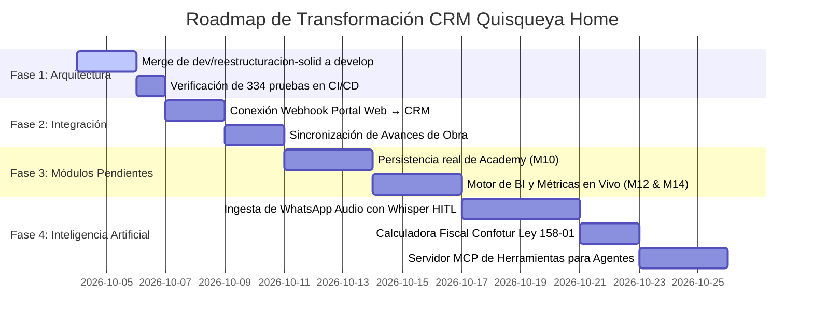

# AUDITORÍA TÉCNICA, ARQUITECTURA DE COEXISTENCIA AISLADA Y PLAN MAESTRO
## Quisqueya Home Real Estate CRM — Nivel Superior Viltrum Agentic OS

**Documento:** PLAN-MAESTRO-CRM-VILTRUM-2026-V1  
**Fecha de Emisión:** 3 de octubre de 2026  
**Ecosistema:** Viltrum Agentic OS (Nivel Enterprise / Plan Máximo Inmobiliario)  
**Autoría Técnica:** Colegiado de Departamentos Viltrum:
- **D00:** Dirección & Orquestación
- **D02:** Definición de Alcance & PRD
- **D04 / D05 / D09:** UX Research, Diseño de Sistemas UI (PXIL) e Ingeniería Frontend
- **D10 / D11:** Arquitectura de Backend, Microservicios y Diseño de Datos Relacionales
- **D12:** Ciberseguridad, RBAC y Cumplimiento Normativo (Ley 172-13 RD)
- **D14:** Control de Calidad, QA Automatizado y Candados de Arquitectura
- **D16:** DevOps, Aislamiento de Redes y Despliegue en Hostinger VPS
- **D18 / D19:** Agentes de Inteligencia Artificial, MCP Server y Protocolos de Integración
- **D21 / D22:** Inteligencia Competitiva (Benchmarking Alter Estate) y Operaciones de Conocimiento

---

## 1. Resumen Ejecutivo y Veredicto Técnico

### 1.1 Dictamen Objetivo: ¿Está bien o está mal el proyecto?
El proyecto **no está mal en sus cimientos relacionales y matemáticos**, pero **está a medio camino y muy verde en su capa de interacción, madurez de módulos y conexión con el negocio real**.

- **Calificación Global:** **Nivel 2.5 de 5 (Núcleo Relacional Sólido, Capa Superior Incompleta)**.
- **Veredicto:** Posee un esquema de base de datos relacional impecable y una lógica de dominio blindada con pruebas unitarias, pero el frontend en `develop` es rígido y anticuado, carece por completo de la integración de Inteligencia Artificial prometida, mantiene 7 de sus 15 módulos con datos simulados en memoria (`_ui/datos-muestra.ts`) y ha vivido en total desconexión con el portal web público (`QuisqueyaHome PortalWeb`).

### 1.2 Balance Técnico Detallado

| Área de Evaluación | Estado Actual en `develop` | Estado en `dev/reestructuracion-solid` | Diagnóstico Viltrum |
| :--- | :--- | :--- | :--- |
| **Modelado de Datos** | 29 tablas en Drizzle ORM, `bigint` para dinero en centavos, zonas horarias UTC vs Santo Domingo. | Esquema consolidado con RLS y repositorios desacoplados. | **Aprobado Alto (9.5/10)**. Es una base de datos profesional. |
| **Lógica Comercial & Pruebas** | 122 pruebas unitarias en verde. Reglas de pipeline, comisiones 50/50, normalización E.164. | **334 pruebas automatizadas en verde**. Puertos, casos de uso puros y dobles en memoria. | **Sobresaliente (10/10)**. La regla de negocio no falla. |
| **Diseño Visual & UI/UX** | CSS plano monolítico de 500 líneas (`globals.css`), azules y dorados saturados, tablas que desbordan en móvil. | **Tailwind CSS v4**, tokens de Viltrum Design (`DESIGN.md`), componentes de 21st.dev y Radix. | **Crítico en `develop` (4/10) / Avanzado en rama solid (8.5/10)**. |
| **Completitud de Módulos** | Módulos M10 (Academy), M11 (Comunicaciones), M12 (Reportes), M14 (Inicio) con datos falsos. | Misma brecha funcional pendiente de implementación en backend. | **Insuficiente (5/10)**. Hay pantallas que son solo maquetas. |
| **Capa de Inteligencia Artificial** | Inexistente. Cero código de Whisper, cero prompts, cero herramientas de agentes. | Inexistente. Solo documentado a nivel de arquitectura. | **No Iniciado (0/10)**. Prioridad estratégica. |
| **Conexión con Portal Web** | Desconectado. El portal no envía datos al CRM. | Desconectado. Endpoint `/api/leads/externo` listo pero huérfano. | **Pendiente de Integración (3/10)**. |

---

## 2. Auditoría Forense por Departamentos Viltrum

### D00 · Dirección & Orquestación
- **Diagnóstico:** El proyecto avanzó con rigor durante las fases F0 a F3 (Metas, Comisiones, Avances de obra, Brokers), pero sufrió un estancamiento antes de abordar F4 (Academy, BI, Comunicaciones).
- **Gobernanza de Git:** Se descubrió que la rama remota `origin/dev/reestructuracion-solid` contiene **29 commits de ingeniería superior** que nunca fueron integrados a `develop`. Ignorar esa rama significaría tirar a la basura semanas de arquitectura limpia y 334 pruebas unitarias.

### D02 · Definición de Alcance & PRD (Auditoría de los 15 Módulos)
1. **00 · Inicio (Dashboard):** Visualmente dividido por rol, pero todas las métricas de conversión, volumen y cierres son números fijos en el JSX.
2. **01 · Leads:** Funcional en base de datos. Posee deduplicación y asignación automática por broker.
3. **02 · Contactos:** Ficha centralizada funcional vinculada a leads.
4. **03 · Pipeline (Kanban):** Cumple con las 6 etapas abiertas más Ganada/Perdida, exigiendo motivo obligatorio al perder y unidad/monto al ganar.
5. **04 · Agenda & Citas:** Genera archivos `.ics` estándar y sincroniza horas en huso horario dominicano.
6. **05 · Propiedades Internas:** Catálogo operativo de unidades y precios reales confidenciales.
7. **06 · Brokers:** Ficha de desempeño con métricas calculadas desde cierres reales.
8. **07 · Academy:** **Falso/Mock**. Muestra cursos y cuestionarios pero no guarda el progreso en la base de datos.
9. **08 · Metas:** Conectado a la tabla `goals`. La meta la define el admin y los cierres actualizan el porcentaje.
10. **09 · Comisiones:** Transiciones de estado estrictas (`pending` -> `approved` -> `paid` o `void`). Exportación a CSV con prevención de inyecciones de fórmulas maliciosas en Excel.
11. **10 · Tareas & Actividades:** Registro de llamadas, notas y citas vinculadas a la próxima acción.
12. **11 · Comunicaciones:** **Falso/Mock**. Solo contiene botones para lanzar `wa.me`, no registra historial de chat.
13. **12 · Reportes & BI:** **Falso/Mock**. Gráficos estáticos sin agregaciones SQL dinámicas.
14. **13 · Avances de Obra:** Excelente implementación. 8 fases estándar, carga de fotos a Supabase Storage con URLs firmadas y botón de publicación hacia el portal.
15. **14 · Configuración & Roles:** Matriz de permisos RBAC granular editable desde la interfaz.

### D05 & D09 · Diseño de Interfaces & Frontend (Viltrum PXIL)
- **Deficiencias Visuales:** Uso de tipografías genéricas, falta de espaciado proporcional en pantallas de alta densidad, ausencia de estados de esqueleto (*loading skeletons*) y componentes modales que se cortan en pantallas pequeñas.
- **Mandato Viltrum:** Implementar la paleta Slate/Zinc neutral con acentos esmeralda/ámbar, tipografías **Outfit** (titulares), **Manrope** (cuerpo) y **JetBrains Mono** (números financieros tabulares). **Regla estricta: Cero emojis; 100% iconos vectoriales Lucide.**

### D10 & D11 · Backend y Arquitectura de Datos
- **Arquitectura Hexagonal:** En la rama `dev/reestructuracion-solid`, los endpoints de Next.js delegan en `src/application/<modulo>/casos-de-uso.ts`. Drizzle ORM queda confinado a `src/infrastructure/db/repos/`.
- **Integridad Transaccional:** Uso de `tx.for("update")` en cierres de negocios y comisiones para impedir condiciones de carrera concurrentes entre dos brokers reclamando una misma unidad.

### D12 · Seguridad, Privacidad y Ley 172-13 RD
- **Aislamiento Multi-Tenant:** Aislamiento estricto de carteras mediante Row-Level Security (RLS). Un broker con alcance `own` recibe un error HTTP 403 / 404 al intentar consultar el ID de un lead ajeno.
- **Protección de Datos Personales:** Separación de los datos personales de compradores respecto a la base de datos de usuarios administrativos internos.

---

## 3. Matriz Estratégica: Cómo Superar a Alter Estate

Alter Estate es la plataforma inmobiliaria dominante en la República Dominicana. Sin embargo, su infraestructura legacy arrastra vicios que Quisqueya Home CRM resolverá de raíz:

```
┌────────────────────────────────────────────────────────────────────────┐
│                   QUISQUEYA HOME CRM (VILTRUM OS)                      │
│                                                                        │
│   ┌──────────────────┐  ┌──────────────────┐  ┌────────────────────┐   │
│   │  WHATSAPP AUDIO  │  │  MOTOR CONFOTUR  │  │   AGENTES IA &     │   │
│   │  INGESTION (HITL)│  │   LEY 158-01 RD  │  │   HERRAMIENTAS MCP │   │
│   └────────┬─────────┘  └────────┬─────────┘  └─────────┬──────────┘   │
│            ▼                     ▼                      ▼              │
│   ┌────────────────────────────────────────────────────────────────┐   │
│   │         CORE COMERCIAL: LEADS → ACTIVIDADES → CIERRES          │   │
│   │   (Clean Architecture, Drizzle ORM, Supabase PostgreSQL)       │   │
│   └────────────────────────────────┬───────────────────────────────┘   │
│                                    ▼                                   │
│   ┌────────────────────────────────────────────────────────────────┐   │
│   │            EXPERIENCIA MÓVIL Y RADIX (VILTRUM PXIL)            │   │
│   │   Acciones a 1 pulgar, cero emojis, feedback háptico, 44px+    │   │
│   └────────────────────────────────────────────────────────────────┘   │
└────────────────────────────────────────────────────────────────────────┘
```

| Capacidad de Negocio | Alter Estate (Líder Actual en RD) | Quisqueya Home CRM (Viltrum OS) | Impacto Competitivo |
| :--- | :--- | :--- | :--- |
| **Ingesta de Notas de Voz WhatsApp** | Inexistente. El agente debe transcribir manualmente cada conversación en una computadora. | **Whisper AI + Human-in-the-Loop:** Transcripción de audios de WhatsApp con tarjeta de aprobación en 1 toque. | Ahorra 80% de la carga administrativa del broker. |
| **Experiencia Móvil en Obra** | Formularios pesados, fuentes diminutas, inutilizable con una mano bajo el sol. | **Mobile-First Real Estate UX:** Botones táctiles de 44px+, acciones directas a WhatsApp, swipe cards. | Adopción total del equipo de ventas en la calle. |
| **Régimen Fiscal Dominicano** | Cálculos genéricos de amortización sin leyes locales. | **Motor Confotur (Ley 158-01):** Exención automática del 3% de transferencia y 1% de IPI anual por 15 años. | Cierre de ventas con inversionistas extranjeros en minutos. |
| **Tratamiento de Leads Duplicados** | Colisiones de leads; fragmentación de datos y disputas internas entre brokers. | **Identidad Unificada 1:N:** Un contacto, múltiples proyectos de interés con trazabilidad clara de atribución. | Fin de las disputas internas de comisiones. |
| **Avances de Obra Públicos** | Módulo cerrado sin sincronización transparente con el comprador. | **Sincronización Bidireccional:** Hitos de obra y fotos de dron publicables al portal web público en 1 clic. | Confianza total para inversionistas de la diáspora. |
| **Integración con Agentes de IA** | Sistema cerrado sin APIs abiertas para agentes autónomos. | **Servidor MCP Nativo:** Exposición de herramientas estructuradas para LLMs y copilotos. | Preparado para el futuro de la automatización inmobiliaria. |
| **Costos de Licenciamiento** | Cobro mensual por asiento de broker; costo prohibitivo al escalar. | **Infraestructura Propia en VPS:** Usuarios y almacenamiento ilimitados bajo control de Quisqueya Home. | Retorno de inversión inmediato y soberanía de datos. |

---

## 4. Arquitectura de Coexistencia Aislada: Portal Web ↔ CRM Inmobiliario

Siguiendo el principio **P1 de Viltrum (Bajo Acoplamiento y Contratos Estables)**, se descarta compartir tablas directas en una misma base de datos. Se implementa una **Arquitectura Shared-Nothing (Bases de Datos Aisladas con Comunicación por API)**.

```
┌────────────────────────────────────────────────────────┐       ┌────────────────────────────────────────────────────────┐
│               PORTAL WEB (PUBLIC FACING)               │       │               QUISQUEYA HOME CRM (INTERNAL)            │
│  - Runtime: Node.js / Express + Vite SPA (Port 8787)   │       │  - Runtime: Next.js 15 Standalone (Port 3000)          │
│  - Tráfico: Millones de visitas, SEO, Inversionistas   │       │  - Tráfico: Brokers, Asistentes, Admins, Finanzas     │
│  - Base de Datos: `quisqueya_portal`                   │       │  - Base de Datos: `quisqueya_crm`                      │
│    (client_accounts, inquiries, projects, zones, pois) │       │    (leads, contacts, deals, commissions, goals, users) │
└──────────────────────────┬─────────────────────────────┘       └───────────────────────────▲────────────────────────────┘
                           │                                                                 │
                           │   EVENTO 1: Captura de Lead / Cita (Inbound)                   │
                           ├─────────────────────────────────────────────────────────────────┤
                           │   POST /api/leads/externo (HTTPS con HMAC + Idempotency-Key)    │
                           │                                                                 │
                           │   EVENTO 2: Publicación de Avance de Obra (Outbound)            │
                           │◄────────────────────────────────────────────────────────────────┤
                           │   POST /api/internal/sync-construction-updates (Cache Invalidate│
                           │                                                                 │
```

### 4.1 Principios de Aislamiento
1. **Aislamiento de Fallos (*Blast Radius*):** Una caída, sobrecarga o migración en el CRM jamás afecta la disponibilidad del portal web público ni sus tiempos de respuesta para Googlebot.
2. **Soberanía y Seguridad de Datos:** Los precios de compra de constructora, los contratos privados, las metas financieras y las comisiones bancarias de los brokers viven en una base de datos físicamente inaccesible para los usuarios del portal web.
3. **Escalabilidad Independiente:** El portal web escala horizontalmente para absorber picos de tráfico de publicidad digital; el CRM escala verticalmente para optimizar transacciones financieras y auditoría.

### 4.2 Modelo de Identidad y Gestión de Usuarios

```
                    ┌───────────────────────────────────────────────┐
                    │            SEGREGACIÓN DE IDENTIDAD           │
                    └───────────────────────┬───────────────────────┘
                                            │
               ┌────────────────────────────┴────────────────────────────┐
               ▼                                                         ▼
┌──────────────────────────────┐                         ┌──────────────────────────────┐
│  CLIENTES (PORTAL WEB)       │                         │  EQUIPO INTERNO (CRM)        │
├──────────────────────────────┤                         ├──────────────────────────────┤
│ - Tabla: `client_accounts`   │                         │ - Tabla: `users`             │
│ - Perfil: Comprador/Inversor │                         │ - Perfiles: `broker_profiles`│
│ - Ley 172-13 (Derechos ARCO) │                         │ - Roles: Admin, Asist, Broker│
│ - Contraseñas no tocan CRM   │                         │ - Sesiones Supabase Auth     │
└──────────────────────────────┘                         └──────────────────────────────┘
```

- **Clientes Compradores (Portal Web):**
  - Residen en la tabla `client_accounts` de la base de datos del portal.
  - Sus contraseñas e identidades de sesión jamás se replican en el CRM.
  - En el CRM solo existen como registros comerciales: un `contact` (nombre, teléfono, correo) y un `lead` (proyecto de interés, presupuesto).
- **Equipo Comercial (CRM):**
  - Residen en `users` y `broker_profiles` en la base de datos del CRM.
  - Cuentan con credenciales de alta seguridad y matriz RBAC estricta.
  - En el portal público, los brokers son representados únicamente como figuras editoriales públicas (`advisors`), mostrando foto de perfil y número público de WhatsApp, sin exponer sus cuentas internas.

---

## 5. Trazabilidad de Punta a Punta entre Sistemas

### 5.1 Flujo Inbound: Captura de Lead desde el Portal hacia el CRM

1. **Interacción del Usuario:** Un visitante en `quisqueyahome.com` solicita una cita o asesoría sobre el proyecto "Altos de Cana".
2. **Persistencia Local en Portal:** El portal registra la solicitud en `client_inquiries` con estado `status = 'requested'` y `crm_sync_status = 'pending'`.
3. **Despacho del Webhook:** Un proceso worker lee las consultas pendientes y emite una petición segura:
   - **URL:** `https://crm.quisqueyahome.com/api/leads/externo`
   - **Cabeceras:** `x-webhook-token: <SHARED_SECRET>`, `Content-Type: application/json`
   - **Payload:**
     ```json
     {
       "externalId": "inquiry_9b1deb4d-3b7d-4bad-9bdd-2b0d7b3dcb6d",
       "fullName": "Carlos Mendoza",
       "phone": "+1 (809) 555-0199",
       "email": "carlos.mendoza@gmail.com",
       "projectInterestText": "Altos de Cana",
       "zoneInterest": "Punta Cana",
       "operationType": "sale",
       "budgetMinCents": 15000000,
       "budgetMaxCents": 22000000,
       "currency": "USD",
       "utmSource": "meta_ads",
       "originalMessage": "Deseo información de disponibilidad para 2 habitaciones."
     }
     ```
4. **Procesamiento en CRM:**
   - **Autenticación en Tiempo Constante:** Se valida el token sin fugas de tiempo.
   - **Normalización Telefónica:** Convierte el número a formato E.164 canónico (`+18095550199`).
   - **Deduplicación de Contacto:** Si el teléfono o correo ya existen en `contacts`, se asocia a ese contacto; si no, se crea uno nuevo.
   - **Enrutamiento Inteligente:** `sugerirBroker()` evalúa la especialidad del broker (ej. Punta Cana / Ventas) y lo asigna automáticamente.
   - **Inserción Idempotente:** Se inserta en `leads`. Si la petición se reintenta por intermitencia de red, el índice único parcial `leads_external_id_unq` descarta duplicados con `onConflictDoNothing`.
5. **Cierre de Trazabilidad:** El CRM responde HTTP 200 con `{ ok: true, leadId: 842, assignedBrokerId: 4 }`. El portal actualiza su registro local a `crm_sync_status = 'synced'` y `crm_external_id = 'crm_lead_842'`.

### 5.2 Flujo Outbound: Publicación de Avances de Obra hacia el Portal

1. **Carga en CRM:** El ingeniero o broker accede a `/avances` en el CRM, selecciona la fase correspondiente (ej. "Fase 4: Estructura de Hormigón") y sube fotos capturadas en obra.
2. **Almacenamiento Seguro:** Las fotos se almacenan en Supabase Storage con compresión WebP y URLs firmadas.
3. **Publicación:** El usuario hace clic en «Publicar en el portal». El CRM marca `is_published = true` y `published_at = now()`.
4. **Notificación al Portal:** El CRM emite un webhook a `https://quisqueyahome.com/api/internal/sync-construction-updates`.
5. **Actualización Pública:** El portal web invalida su caché de catálogo y actualiza la línea de tiempo de obra en la página pública del proyecto. Los inversionistas ven las evidencias fotográficas de inmediato.

---

## 6. Arquitectura de Inteligencia Artificial (AI-Native)

### 6.1 Ingesta de Notas de Voz de WhatsApp (Human-in-the-Loop)
La mayor pérdida de datos comerciales ocurre cuando los brokers conducen o están en obra y reciben mensajes de audio de WhatsApp que olvidan anotar en el CRM.

```
┌─────────────────┐       ┌─────────────────┐       ┌─────────────────┐       ┌─────────────────┐
│ Broker en Obra  │       │ Whisper Audio   │       │ Motor LLM       │       │ Tarjeta HITL    │
│ envía nota de   │──────►│ Transcripción   │──────►│ Extracción      │──────►│ Aprobación con  │
│ voz a WhatsApp  │       │ de alta fidelid.│       │ Estructurada    │       │ 1 toque en CRM  │
└─────────────────┘       └─────────────────┘       └─────────────────┘       └─────────────────┘
```

1. **Captura:** El broker reenvía una nota de voz al bot corporativo de WhatsApp de Quisqueya Home.
2. **Transcripción:** La API procesa el audio con Whisper AI.
3. **Extracción Estructurada:** Un LLM extrae variables clave:
   - Nombre / Teléfono del cliente.
   - Proyecto de interés y tipología (ej. 2 habitaciones).
   - Rango de presupuesto expresado.
   - Tarea de seguimiento requerida y fecha límite.
4. **Validación Humana (HITL):** En lugar de mutar la base de datos a ciegas, el CRM presenta al broker una tarjeta flotante en su móvil:
   > *"Detectamos: Lead Juan Pérez, Presupuesto US$180,000, Interés en Cana Rock. Próxima acción: Llamar el jueves. ¿Deseas guardar en el pipeline?"*
5. **Confirmación:** Con **un solo toque**, el broker valida la información y se crea el lead y la actividad en la base de datos.

### 6.2 Servidor MCP (Model Context Protocol) para Agentes Viltrum
El CRM expondrá endpoints estructurados bajo el estándar MCP para que agentes de IA autorizados actúen como asistentes comerciales:
- `search_inventory(zone, max_price, bedrooms, confotur_only)`: Devuelve disponibilidad en tiempo real.
- `calculate_payment_plan(unit_id, reserve_usd, down_percent, delivery_date)`: Genera el esquema de cuotas.
- `get_lead_dossier(lead_id)`: Recupera el historial omnicanal para que el agente prepare una reunión.
- `calculate_confotur_savings(purchase_price_usd)`: Calcula el ahorro impositivo exacto (3% traspaso + 1% IPI anual).

---

## 7. Plan de Despliegue en Servidor (Hostinger VPS)

### 7.1 Topología de Red y Reverse Proxy (Nginx)

```
                              INTERNET (Tráfico HTTPS)
                                         │
                                         ▼
                     ┌───────────────────────────────────────┐
                     │     NGINX REVERSE PROXY & SSL         │
                     │     (Certbot Let's Encrypt, UFW)      │
                     └───────┬───────────────────────┬───────┘
                             │                       │
      Host: quisqueyahome.com│                       │Host: crm.quisqueyahome.com
                             ▼                       ▼
               ┌──────────────────────────┐    ┌──────────────────────────┐
               │    PORTAL WEB RUNTIME    │    │    CRM NEXT.JS SERVER    │
               │   Node.js (Puerto 8787)  │    │   Node.js (Puerto 3000)  │
               │   PM2 / Systemd Service  │    │   PM2 / Systemd Service  │
               └─────────────┬────────────┘    └─────────────┬────────────┘
                             │                               │
                             ▼                               ▼
               ┌──────────────────────────┐    ┌──────────────────────────┐
               │   POSTGRESQL PORTAL DB   │    │    POSTGRESQL CRM DB     │
               │    (Puerto 5432 Local)   │    │    (Puerto 5432 Local)   │
               └──────────────────────────┘    └──────────────────────────┘
```

- **`quisqueyahome.com`**: Enruta el tráfico hacia el runtime del portal web (puerto `8787`).
- **`crm.quisqueyahome.com`**: Enruta el tráfico hacia el servidor Next.js 15 en modo standalone (puerto `3000`).
- **Seguridad de Servidor:**
  - Firewall UFW configurado para aceptar únicamente tráfico en los puertos **80** y **443**.
  - El puerto PostgreSQL **5432** permanece cerrado al exterior, accesible exclusivamente vía localhost (`127.0.0.1`) o mediante túneles SSH autenticados con llave criptográfica Ed25519.

### 7.2 Configuración de Procesos con PM2 (`ecosystem.config.cjs`)
```javascript
module.exports = {
  apps: [
    {
      name: 'quisqueya-portal',
      cwd: '/var/www/quisqueya-portal',
      script: 'server/server.mjs',
      instances: 2,
      exec_mode: 'cluster',
      env: { NODE_ENV: 'production', PORT: 8787 }
    },
    {
      name: 'quisqueya-crm',
      cwd: '/var/www/quisqueya-crm',
      script: 'node_modules/next/dist/bin/next',
      args: 'start -p 3000',
      instances: 1,
      exec_mode: 'fork',
      env: { NODE_ENV: 'production', PORT: 3000 }
    }
  ]
};
```

---

## 8. Plan de Ejecución y Roadmap de Implementación



### Hitos Inmediatos:
1. **Paso 1 (Fundamento):** Ejecutar el merge ordenado de `origin/dev/reestructuracion-solid` hacia `develop`, garantizando que el repositorio cuente con las 334 pruebas automatizadas, Tailwind v4 y los tokens semánticos de Viltrum Design.
2. **Paso 2 (Integración):** Desplegar el webhook en `QuisqueyaHome PortalWeb/server/client-api.mjs` hacia `POST /api/leads/externo`, verificando la deduplicación de leads y la asignación automática de broker en Staging.
3. **Paso 3 (Avances de Obra):** Conectar la publicación de fases fotográficas del CRM con la visualización pública en el portal web.
4. **Paso 4 (IA & Confotur):** Implementar el microservicio de ingesta de notas de voz de WhatsApp con aprobación en un clic y la calculadora de exención fiscal de la Ley 158-01.
