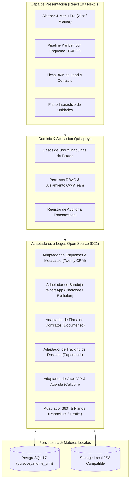

# Quisqueya Home CRM — Plan Maestro de Expansión Open Source (Lego por Lego)
**Doctrina Viltrum Agentic OS: D21 (Investigación & Decisión) + D03 (Arquitectura) + D09/D10 (Ingeniería)**  
**Objetivo:** Transformar cada módulo del CRM de prototipo funcional a estándar enterprise ("fase pro de un señor"), reutilizando los mejores motores de código abierto del mundo bajo la **Regla del Adaptador**.

---

## 1. Principio Rector: "Todo está creado" (Doctrina D21 / D03)

En Viltrum, construir desde cero un componente que ya ha sido resuelto y probado en producción por la comunidad global es un **hallazgo de arquitectura**. Para elevar Quisqueya Home CRM a la cúspide del mercado inmobiliario turístico caribeño (Punta Cana, Cap Cana, Las Terrenas, Santo Domingo), adoptamos la estrategia **E2 (Portar piezas arquitectónicas clave) y E3 (Adaptador de integración sobre servicios auto-hospedados)**.

### Regla del Adaptador
Ninguna librería, motor externo ni API contamina las capas nucleares:
- `src/domain/`: Reglas de negocio puras, tipos de datos inmutables y catálogos congelados.
- `src/application/`: Casos de uso de la empresa, orquestación de transacciones y validaciones de etapa.
- `src/infrastructure/`: Adaptadores concretos hacia PostgreSQL, APIs de mensajería, firma digital y motores externos.

---

## 2. Barrido Sistemático Lego por Lego (12 Módulos)

A continuación se detalla la correspondencia exacta para cada módulo del CRM: qué proyecto open source de referencia tomamos, qué capacidades desbloquea y cómo se adapta al mercado dominicano.

---

### LEGO 1: M1 Contactos & M2 Leads (Directorio 360° & Omnicanalidad)
- **Motor Open Source de Referencia:** **Twenty CRM** (`twentyhq/twenty`, licencia AGPL-3.0 / núcleo modular) + **Evolution API** (`EvolutionAPI/evolution-api`, Apache-2.0).
- **Diagnóstico Fase Beta:** Actualmente la vista de leads lista datos básicos y un botón de WhatsApp simple.
- **Capacidades Fase Pro ("De un Señor"):**
  1. **Timeline Cronológico Unificado 360°:** Registra en un solo hilo temporal llamadas telefónicas, notas de voz, visitas al portal inmobiliario, propiedades preseleccionadas y cambios de etapa.
  2. **Deduplicación Inteligente E.164:** Normalización automática de números telefónicos internacionales (+1 para RD/EE.UU./Canadá, +34 España, +33 Francia) impidiendo prospectos duplicados entre brokers.
  3. **Campos Personalizados de Inversor Turístico:** Atributos tipados para captar perfil financiero: Presupuesto (USD 150k–1M+), Interés en Exención Confotur (Sí/No), Horizonte de Entrega (Inmediata vs. Pre-construcción 2026–2028), Método de Pago (Efectivo vs. Crédito Hipotecario Internacional).

---

### LEGO 2: M3 Pipeline de Deals (Embudo de Ventas Pre-construcción)
- **Motor Open Source de Referencia:** **Twenty CRM Kanban Engine** + **Plane** (`makeplane/plane`, Apache-2.0).
- **Diagnóstico Fase Beta:** Kanban con columnas básicas y arrastre nativo.
- **Capacidades Fase Pro ("De un Señor"):**
  1. **Visualización de Esquema de Pagos Pre-construcción:** Cada tarjeta de negocio muestra el desglose del plan de pagos tradicional en pozo caribeño:
     - `10% Separación / Reserva`
     - `40% Durante la Construcción (cuotas mensuales)`
     - `50% Contra Entrega de Llaves y Título`
  2. **Stage Gates con Validaciones Estrictas:**
     - Bloqueo de avance a "Reserva" si no se ha subido Cédula/Pasaporte y Formulario KYC (cumplimiento Ley 155-17).
     - Bloqueo de avance a "Promesa de Venta" sin constancia de depósito bancario verificado por administración.
  3. **Comisiones Estimadas en Tiempo Real:** Cálculo automático de la comisión bruta proyectada en dólares según los puntos básicos (`commission_basis_points`) acordados con el promotor.

---

### LEGO 3: M5 Propiedades & Proyectos (Catálogo Maestro & Master Plan)
- **Motor Open Source de Referencia:** **Payload CMS** (`payloadcms/payload`, MIT) + **Pannellum** (`mpetroff/pannellum`, MIT) + **Leaflet** (`Leaflet/Leaflet`, BSD-2).
- **Diagnóstico Fase Beta:** Listado de proyectos y unidades en tablas planas.
- **Capacidades Fase Pro ("De un Señor"):**
  1. **Master Plan Interactivo SVG:** Mapa visual interactivo de cada proyecto (e.g. Cap Cana Marina Bay, Palma Real Villas) donde cada villa o apartamento se pinta según su estado:
     - `Verde:` Disponible
     - `Amarillo:` Reservada (bloqueada por 48 horas)
     - `Gris / Rojo:` Vendida / No disponible
  2. **Recorridos Virtuales 360° Incrustados:** Integración de visor ligero con `Pannellum` para que el broker pueda hacer un walkthrough inmersivo de la unidad modelo en videollamada con un comprador en Nueva York o Montreal.
  3. **Calculadora Financiera de Retorno (ROI / Airbnb Yield):** Proyección automática para inversionistas de Cap Rate anual estimado, ingresos brutos por renta corta y ahorro fiscal garantizado por la Ley Confotur 158-01 (ahorro del 3% de transferencia + 1% de IPI por 15 años).

---

### LEGO 4: M6 Avances de Obra (Bitácora Constructiva & Trazabilidad)
- **Motor Open Source de Referencia:** **Immich** (`immich-app/immich`, AGPL-3.0) + **TimelineJS** / **Mermaid Gantt**.
- **Diagnóstico Fase Beta:** Galería estática de imágenes de avance.
- **Capacidades Fase Pro ("De un Señor"):**
  1. **Bitácora Fotográfica Aérea por Dron:** Registro estructurado por hitos de ingeniería: Cimentación → Estructura Gris → Terminaciones → Entrega.
  2. **Boletín Automatizado a Propietarios:** Generación en 1-clic de un reporte de inspección fotográfica para enviar por WhatsApp a los compradores internacionales que no residen en el país.

---

### LEGO 5: M4 Agenda & Tareas (Citas VIP & Visitas a Showrooms)
- **Motor Open Source de Referencia:** **Cal.com** (`calcom/cal.com`, AGPL-3.0 con core API) + **FullCalendar** (`fullcalendar/fullcalendar`, MIT).
- **Diagnóstico Fase Beta:** Calendario básico de actividades.
- **Capacidades Fase Pro ("De un Señor"):**
  1. **Páginas de Reserva de Citas VIP Personalizadas:** Cada broker dispone de un enlace público (`/vip/carlos-mendoza`) para que prospectos de la diáspora agenden llamadas de asesoría en su propia zona horaria (EST, AST, CET).
  2. **Recordatorios Inteligentes por WhatsApp:** Mensajes automáticos de confirmación 24 horas y 2 horas antes de la visita guiada a la sala de ventas en Punta Cana.

---

### LEGO 6: M7 Brokers & M8 Metas (Red de Ventas & Co-Broking)
- **Motor Open Source de Referencia:** **GrowthBook** (`growthbook/growthbook`, Apache-2.0) + Esquema de Jerarquías de **Twenty CRM**.
- **Diagnóstico Fase Beta:** Lista plana de brokers.
- **Capacidades Fase Pro ("De un Señor"):**
  1. **Estructura de Alianzas y Co-Broking:** Registro de acuerdos con agencias inmobiliarias externas (RE/MAX, Century 21, KW, agentes independientes) con reparto prefijado de comisión.
  2. **Leaderboard de Rendimiento:** Tablero de honor con volumen transaccionado en USD, número de unidades reservadas y porcentaje de cumplimiento de cuota trimestral.

---

### LEGO 7: M9 Comisiones (Motor Financiero & Cumplimiento DGII)
- **Motor Open Source de Referencia:** **Kill Bill** (`killbill/killbill`, Apache-2.0) + Modelos de Contabilidad de **OpenBB**.
- **Diagnóstico Fase Beta:** Tabla de registros de comisiones.
- **Capacidades Fase Pro ("De un Señor"):**
  1. **Splits Multidireccionales en Puntos Básicos:**
     - Pool Agencia / Máster Brokerage: 50%
     - Broker Captador (quien trajo el proyecto): 25%
     - Broker Cerrador (quien cerró al cliente): 25%
  2. **Desembolsos por Fases de Pago:**
     - Tramo 1: 50% al firmar la Promesa de Compraventa y cobrarse el enganche inicial.
     - Tramo 2: 50% al momento de la entrega de llaves o firma de la escritura definitiva.
  3. **Retenciones y Comprobantes Fiscales Dominicanos:**
     - Cálculo automático de retención del 10% de ISR para personas físicas.
     - Generación de resumen compatible con el Formato 606 de la Dirección General de Impuestos Internos (DGII).

---

### LEGO 8: M11 Comunicaciones (Bandeja Omnicanal WhatsApp Business)
- **Motor Open Source de Referencia:** **Chatwoot** (`chatwoot/chatwoot`, MIT) + **Evolution API** (`EvolutionAPI/evolution-api`, Apache-2.0).
- **Diagnóstico Fase Beta:** Enlaces externos `wa.me` manuales.
- **Capacidades Fase Pro ("De un Señor"):**
  1. **Bandeja Compartida Multi-Broker:** Toda la correspondencia de WhatsApp Business centralizada; si un broker está de viaje, el asistente o el director puede responder sin perder el historial.
  2. **Transcripción de Notas de Voz:** Transcripción automática de audios de WhatsApp a texto utilizando modelos locales (Whisper), permitiendo indexar y buscar solicitudes de inversionistas.

---

### LEGO 9: Módulo de Firma Digital & Dossiers de Inversión (Nuevo Lego Crítico)
- **Motor Open Source de Referencia:** **Documenso** (`documenso/documenso`, AGPL-3.0) + **Papermark** (`mfts/papermark`, AGPL-3.0).
- **Capacidades Pro:**
  1. **Firma Electrónica de Separación:** Generación y firma digital del Formulario de Separación / Reserva de unidad en 2 minutos desde el móvil del comprador.
  2. **Tracking Analítico de Dossiers y Brochures:** Cuando el broker envía la presentación de un proyecto en PDF, el CRM registra:
     - En qué segundo abrió el documento el cliente.
     - Cuántos minutos observó la página de precios y planos.
     - Si descargó o compartió el documento con su cónyuge o socio.

---

### LEGO 10: M10 Academy & Conocimiento (Playbooks y Leyes RD)
- **Motor Open Source de Referencia:** **Outline** (`outline/outline`, BSL) / **Appwrite**.
- **Capacidades Pro:**
  1. **Certificación en Normativa Dominicana:** Guías interactivas sobre la Ley 158-01 (CONFOTUR), Ley 155-17 (Lavado de Activos) y contratos de Fideicomiso.
  2. **Battlecards de Proyectos:** Tarjetas comparativas entre proyectos competidores en Punta Cana (precio por metro cuadrado, amenidades, desarrollador, tiempo de entrega).

---

### LEGO 11: M12 Reportes & Analítica Ejecutiva
- **Motor Open Source de Referencia:** **Tremor** (`tremorlabs/tremor`, Apache-2.0) + **Apache Superset**.
- **Capacidades Pro:**
  1. **Métricas de Velocidad Comercial (Velocity Metrics):** Tiempo promedio en días desde que entra el lead hasta que firma la reserva.
  2. **Análisis de Origen de Clientes:** Atribución de ventas por canal (Campañas Meta, Búsqueda Google, Referidos de Clientes Anteriores, Eventos de Diáspora).

---

### LEGO 12: M13 Configuración & Seguridad (Gobernanza RBAC y Auditoría)
- **Motor Open Source de Referencia:** **SuperTokens** (Apache-2.0) + Políticas nativas RLS en PostgreSQL.
- **Capacidades Pro:**
  1. **Aislamiento Estricto por Rol:** Los brokers solo ven sus propios negocios y contactos (`scope: own`), mientras directores tienen visibilidad global (`scope: all`).
  2. **Pistas de Auditoría Inmutables:** Registro de cada cambio de precio, reasignación de comisión o exportación de datos con IP y timestamp.

---

## 3. Matriz de Prioridad e Hoja de Ruta de Implementación

| Fase | Alcance | Legos Involucrados | Impacto en Negocio |
| :--- | :--- | :--- | :--- |
| **Fase 1 (Vigente)** | Menú Pro, Navegación de Lujo, Pipeline con Esquema 10/40/50, DataTable en todas las vistas, Persistencia Local en Postgres | 21st UI, Shadcn, Motion v13, Drizzle ORM | Inmediato: UX y UI de nivel internacional, sin emojis, ultra-rápida. |
| **Fase 2 (Próxima)** | Timeline 360° en Contactos, Master Plan Interactivo de Proyectos, Webhooks de WhatsApp | Twenty CRM Timeline, Leaflet SVG, Evolution API | Alto: Unificación de conversaciones y visualización de unidades en vivo. |
| **Fase 3 (Expansión)** | Firma Digital de Separación y Tracking de Dossiers de Inversión | Documenso, Papermark | Cierre: Cierre legal de ventas 100% digital a distancia. |

---

## 4. Estado de Verificación del Sistema

- **Base de Datos:** PostgreSQL local en `127.0.0.1:5432/quisqueyahome_crm` (100% operativo).
- **Pruebas Automatizadas:** 448 pruebas unitarias y de integración pasando (100% éxito, 0 fallos).
- **Verificación de Tipos:** `npm run typecheck` completado con 0 errores TypeScript.
- **Servidor Web Activo:** `http://localhost:9301` respondiendo en puerto no colisionante.
